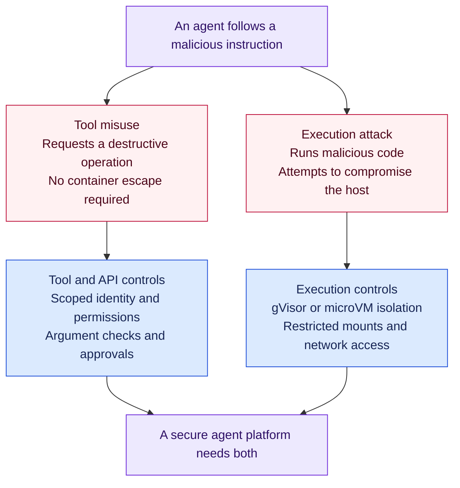

# Agent Sandbox vs Agent Substrate

**Recommendation: prioritise Substrate if our target needs stateful agent execution, while tightening tool permissions now. Defer a separate Agent Sandbox deployment unless it meets an immediate requirement.**

This is an architectural recommendation based on upstream sources checked on 30 October 2026. It is not a finding from our workplace cluster or a measured comparison of engineering cost.

## Is the reasoning sound?

| Starting view | Assessment |
|---|---|
| An agent can cause damage through the tools it can access. | Correct. An allowed destructive operation needs no container escape. Enforce permissions at the tool server, workflow, or destination API. |
| Kubernetes Pods already provide all the isolation we need. | Too strong. Ordinary containers share the host kernel. A userspace kernel or microVM adds a boundary against malicious code and container escape. [Kubernetes guidance](https://kubernetes.io/docs/concepts/security/multi-tenancy/#sandboxing-containers) |
| Agent Sandbox is mainly useful on a developer's computer. | Incorrect for this project. Kubernetes Agent Sandbox manages remote, stateful Pods, including shared-cluster agent execution environments. [Project overview](https://github.com/kubernetes-sigs/agent-sandbox) |
| Agent Sandbox does not provide the full Substrate operating model. | Correct. There is overlap in isolation and lifecycle, but the default resource models and integrated services differ. See the comparison below. |
| Implementing Agent Sandbox would waste engineering effort. | Possible, but not established. A second lifecycle platform may duplicate work. Agent Sandbox can also be sufficient when the requirement is an isolated persistent workspace. |

The distinction is between **abusing permitted actions** and **escaping the execution environment**. We need controls for both. Which risk dominates depends on the tools, credentials, code execution, and tenants we actually expose.

## Two separate security problems

For example, an agent allowed to delete a production Deployment can request that deletion from inside a perfectly isolated sandbox. A network allowlist and hidden credentials do not make the permitted operation safe. Kubernetes recommends least privilege and warns about permissions that enable escalation. [RBAC guidance](https://kubernetes.io/docs/concepts/security/rbac-good-practices/)

**Put the control where execution happens.** If a remote MCP server executes shell commands, its Pod and permissions need protection. Sandboxing only the agent process does not sandbox code executed by that separate server.

## What each option adds

The baseline here is an ordinary hardened Pod without a sandbox runtime or a separate agent lifecycle platform.

| Capability | Existing Pods | Kubernetes Agent Sandbox | Agent Substrate |
|---|---|---|---|
| Main responsibility | Run application containers. | Manage isolated, persistent singleton environments. | Run logical, stateful agents on reusable workers. |
| Host isolation | Shared host kernel under a conventional runtime. | Select gVisor or Kata through an installed and enforced `RuntimeClass`. | Requires supported gVisor or microVM sandboxes. |
| Lifecycle and capacity | Application-specific session management. | Templates, claims, stable identity, persistent storage, and warm pools. | Actor lifecycle, reusable worker pools, snapshots, and routing that resumes agents. |
| State across a pause | Recreated processes need external state. | Base suspension retains persistent volumes and recreates the Pod. RAM requires a snapshot integration. | Saves and restores memory and filesystem state through supported snapshot modes. |
| Identity and credentials | Configure service accounts, secret handling, and gateways. | Compose platform identity and credential services around the sandbox. | Integrates actor identity and policy-controlled credential injection outside the agent sandbox. |
| Tool permissions and approvals | Enforce at the backend. | Still enforce at the backend. | Still enforce at the backend. |
| Operating effort | Maintain existing application controls. | Add controllers, runtime configuration, templates, storage, and policy. | Also operate the actor control plane, state store, snapshot storage, supervisors, and network mediation. |

Sources for the table: [Agent Sandbox overview](https://github.com/kubernetes-sigs/agent-sandbox), [suspension semantics](https://github.com/kubernetes-sigs/agent-sandbox/blob/main/docs/keps/694-kep-for-suspend-and-resume-for-beta/README.md), [Substrate architecture](https://github.com/agent-substrate/substrate/blob/main/docs/concepts/architecture.md), [credential injection](https://github.com/agent-substrate/substrate/blob/main/docs/guides/egress-credential-injection.md).

Agent Sandbox has real security value. Its template path documents managed network policies and disables service-account token automount by default when omitted. These defaults do not apply identically to bare Sandbox resources. Its default public-Internet egress also needs tightening for service-specific access. [Threat model](https://github.com/kubernetes-sigs/agent-sandbox/blob/main/docs/security/threat_model.md)

Agent Sandbox also documents a **GKE-specific snapshot extension** that preserves memory and filesystem state. Snapshotting is therefore not exclusive to Substrate. That extension requires GKE facilities and is not evidence of a portable AKS solution. [Snapshot extension](https://github.com/kubernetes-sigs/agent-sandbox/blob/main/clients/python/agentic-sandbox-client/k8s_agent_sandbox/gke_extensions/snapshots/README.md)

With the same correctly configured sandbox runtime, we should not assume Substrate offers stronger host isolation merely because it has more platform features.

## Where Microsoft's and Google's implementations fit

Google AX orchestrates tasks on Substrate. Microsoft's open-source Agent Sessions supports Substrate as a pluggable backend and adds durable session records, replay, and forks. These are application and session layers above compute; their full capabilities should not be attributed to the underlying sandbox alone. [Google AX](https://github.com/google/ax), [Agent Sessions](https://github.com/agent-primitives/sessions), [Substrate integration tests](https://github.com/agent-primitives/sessions/blob/main/docs/substrate-conformance.md)

## Recommended investment

1. **Tighten tool access now.** Use typed operations, bounded arguments, scoped backend identities, and enforced approval for resource-changing actions. Neither platform replaces this work.
2. **Validate Substrate against our actual need.** Prove memory and file restoration, denied access between agents, credential handling, recovery, and cleanup on the approved Kubernetes runtime. Check mirrored runtime assets and snapshot storage where external downloads are restricted. AKS managed Kata and Substrate's actor backend require separate compatibility checks.
3. **Defer a second lifecycle controller unless it solves a gap.** Choose Agent Sandbox if a persistent isolated workspace meets the requirement sooner with acceptable operating cost. Existing hardened Pods may suffice for trusted agents limited to typed, read-only tools.

If untrusted code execution is needed before Substrate is available, provide appropriate isolation then. Waiting for the target platform does not remove that risk.

Substrate remains pre-1.0. Its security documentation marks some controls, including comprehensive quotas and parts of tenant isolation and cleanup, as unfinished. Saved state is not a guarantee of zero data loss, exactly-once external actions, or complete disaster recovery. These limits belong in the evaluation. [Implementation status](https://github.com/agent-substrate/substrate/blob/main/docs/security/security.md)

**The defensible position is to avoid duplicate platform work while retaining both tool authorisation and execution isolation. Substrate is a broader target, not a replacement for least privilege.**
