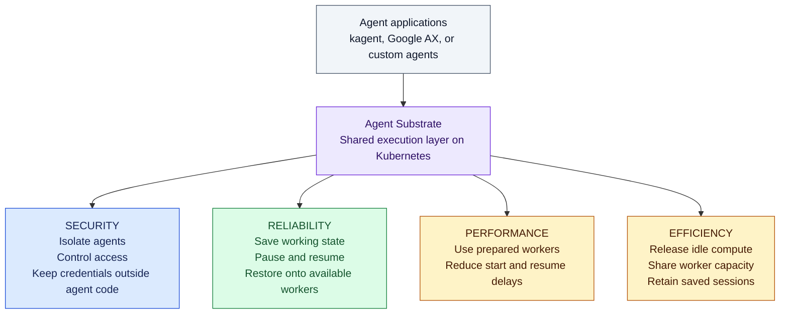

# Agent Substrate: security, reliability, performance, and efficiency

**We are evaluating Substrate to give agents isolated execution, controlled access, and continuity across pauses, alongside faster starts and better use of infrastructure.**

An agent can execute code, call tools, create files, and wait for human approval. Its execution environment needs to control those actions and preserve its working state.

## Where the value comes from

This diagram shows the responsibilities of the execution layer. The arrows describe capabilities, not network traffic.

| Area | What Substrate provides | Business value |
|---|---|---|
| **Security** | Each agent runs in a gVisor or microVM sandbox. Network access is restricted. A gateway can inject approved credentials outside the sandbox. | Limits the impact of faulty or compromised agent code and reduces exposure of reusable credentials. Controls operate outside the agent's prompt. [Security documentation](https://github.com/agent-substrate/substrate/blob/main/docs/security/security.md) |
| **Reliability** | Snapshots preserve memory and filesystem state across suspension. An agent can resume from saved state on an available worker. | Supports workflows that span pauses and human approvals without keeping the original process continuously running. [Runtime overview](https://github.com/agent-substrate/substrate) |
| **Performance** | Prepared workers restore agents without provisioning a fresh Kubernetes Pod for each activation. | Reduces the delay before useful work begins. [Architecture](https://github.com/agent-substrate/substrate/blob/main/docs/concepts/architecture.md) |
| **Efficiency** | Suspended agents release compute. A smaller pool of workers serves many saved agent sessions. | Reduces resources held by idle sessions. Actual savings depend on workload and storage costs. [Architecture](https://github.com/agent-substrate/substrate/blob/main/docs/concepts/architecture.md) |

## A practical example

An incident-triage agent gathers evidence and prepares a remediation proposal. The application pauses for an authorised engineer's approval.

- Security controls restrict the agent to approved services and keep reusable credentials outside its code.
- The runtime saves the agent's working state so the workflow can continue after the pause.
- Idle compute becomes available for other agents.
- On the next invocation, the runtime restores the saved agent onto an available worker.

This combines the security and snapshot capabilities described in the [Substrate documentation](https://github.com/agent-substrate/substrate). The application still owns approval checks and permission to execute remediation.

## Why platforms are adding this layer

Google AX explicitly uses Agent Substrate for sandboxed task execution. Microsoft Foundry hosted sessions use a similar pattern of isolated sessions, persisted files, and released idle compute. Microsoft's documentation does not establish that it uses Agent Substrate. [Google AX](https://github.com/google/ax), [Microsoft hosted sessions](https://learn.microsoft.com/en-us/azure/foundry/agents/how-to/manage-hosted-sessions)

These examples support a common direction: make agent execution a shared platform responsibility, so each application team does not have to build its own isolation and session lifecycle.

## What our evaluation needs to establish

Substrate is pre-1.0. Current upstream documentation is not evidence that our installed version has every capability. Some security controls, including comprehensive quotas and parts of tenant isolation, remain unfinished. [Project status](https://github.com/agent-substrate/substrate#status-and-compatibility), [Security implementation status](https://github.com/agent-substrate/substrate/blob/main/docs/security/security.md)

We need to verify isolation, denied network access, credential handling, and restoration of saved state in our environment. Snapshot restoration does not guarantee zero data loss after a crash or prevent duplicate external actions. Application permissions, approval checks, backups, and safe retries remain necessary.

**The business case covers risk reduction and continuity of work, as well as speed and infrastructure cost.**
