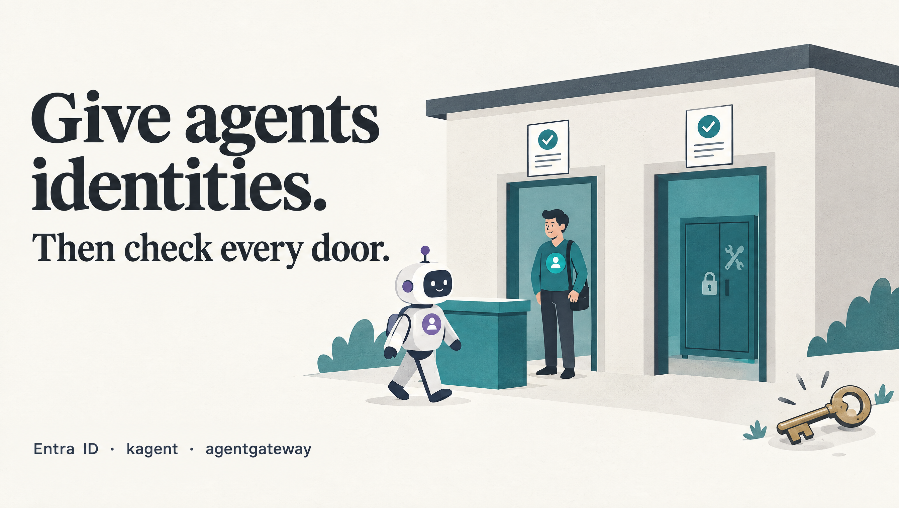
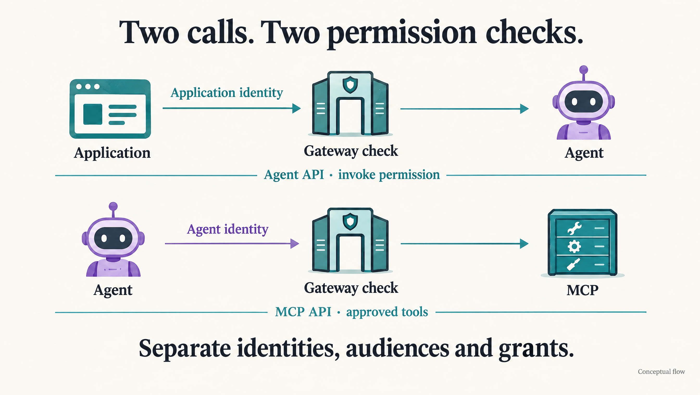
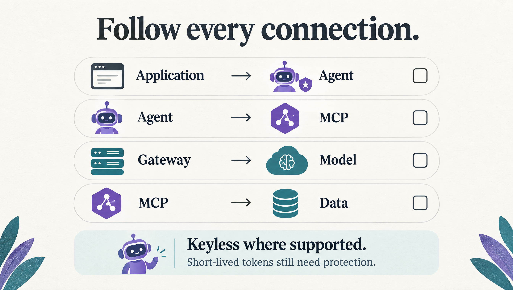

# Give AI agents identities. Check every boundary.

*What we’re designing with Microsoft Entra ID, kagent and agentgateway, and where the work still needs proof.*

*Separate identities and permissions at each boundary.*

John Fox’s post on taking shared model-provider keys out of agent pods prompted a question about our own work: where can we avoid creating those keys altogether?[1]

We’re designing separate identity checks for application-to-agent and agent-to-tool calls using Microsoft Entra ID, kagent and agentgateway. Federation can remove static client secrets from those connections. This walkthrough explains the design and our examples; automatic token renewal and the complete workplace path still need validation.

## The problem, explained simply

Imagine an office with a reception desk, a specialist who answers questions, and a room full of tools.

An application arrives at reception and asks to speak to the specialist. Reception checks its badge and appointment.

The specialist then needs a tool. At the tool-room door, there’s another check: does this specialist have permission to use this particular tool?

Getting through reception doesn’t give the visitor the specialist’s badge. And being a recognised specialist doesn’t unlock every cupboard.

The application may call a named agent. The agent, using its own identity, may call approved tools. Where a door can recognise an identity, we can avoid handing out copies of a permanent master key.

## The technical version

**kagent** runs the agent. **agentgateway** routes requests and enforces access policy. **Microsoft Entra ID** issues the access tokens; the gateway validates them.

MCP (Model Context Protocol) connects agents to tools. Our calling application invokes the agent over its A2A (Agent2Agent) API. Each API requires a token intended for it and an explicit permission.

## 1. The threat: a shared secret travels too far

Copying an API key into several workloads is convenient. It also means a compromise of any workload that can read it may expose the shared credential.

Agents can read untrusted text and execute tools. Encrypting a key in Git doesn’t prevent a compromised running process from reading its decrypted copy.

Sharing the credential also complicates attribution and withdrawing one agent’s access independently. Moving it to a gateway reduces exposure. Federation can go further where the destination accepts identity tokens.

## 2. The idea: establish trust through federation

On AKS, Workload Identity can exchange a projected Kubernetes ServiceAccount token for an Entra access token using a configured federation relationship.[2]

For the incoming application call, our design uses a user-assigned managed identity, or UAMI. For the outgoing MCP call, it uses an **agent identity** created from an **agent identity blueprint** in Microsoft Entra Agent ID.[3]

These are separate identities, with separate audiences and grants:

| Request | Identity | Intended permission |
| --- | --- | --- |
| Application → agent API | Calling application’s UAMI | Invoke the named agent |
| Agent → MCP API | Agent’s own agent identity | Use approved MCP operations |

The application’s token is not reused as the agent’s MCP credential. These are application permissions; carrying a signed-in person’s permissions downstream requires an explicit delegated or on-behalf-of design.

*The application invokes the agent with its own identity. The agent invokes MCP with a different identity and grant.*

## 3. The pieces: who issues, who checks, who executes

**The caller identity.** The calling workload obtains a token for the agent API. The gateway checks the approved caller identity and its invoke role on the named route.

**The agent identity.** A token component authenticates the blueprint through a configured federated credential, then performs the exchange to acquire an agent identity token for the MCP API. The agent identity carries its permissions and audit identity.[3]

That first step is essential: using a client secret to authenticate the blueprint would leave a static secret in the chain. Our design instead federates the token-holder’s Kubernetes ServiceAccount to the blueprint.

**The gateway policy.** Our examples require a trusted issuer, a valid signature, an unexpired token, the expected API audience, the exact approved identity and the required role. On the MCP route, it additionally restricts tool operation names.[5]

**The destination controls.** The MCP service must constrain arguments and resource scope. Downstream Kubernetes RBAC or database grants enforce its resource permissions.

**The network boundary.** Network controls must prevent callers from bypassing the gateway to reach unprotected backends.

These checks serve different purposes. An Entra role assignment, a gateway tool rule and Kubernetes RBAC aren’t interchangeable permissions.

## 4. Why the runtime matters as much as the YAML

A ServiceAccount annotation doesn’t implement the complete exchange. A token component or supported library must acquire the right token, renew it, and supply it to the client.[3]

Our MCP example currently supplies the Authorization header through a Kubernetes Secret. The model configuration also references a credential Secret for its gateway connection. Updating a Secret doesn’t establish that a running client reloads it; that behaviour needs testing.

The token component might live in the application, a sidecar or a broker. We must establish which process can read the credential and which requests it can make. A sidecar can reduce direct token exposure while still giving a compromised agent a connection it can misuse.

## 5. The proof: make the wrong requests fail

A successful chat response proves that a route can work. It doesn’t prove the permission boundary.

This is the target test matrix for our design, **not a table of newly observed results**:

| Request | Required outcome |
| --- | --- |
| Missing, malformed or expired token | Reject before backend access |
| Valid token for the wrong API audience | Reject |
| Valid token from an unapproved caller or agent identity | Deny access |
| Approved identity without the required role | Deny access |
| Approved agent asks for an unapproved MCP tool | Deny the tool call |
| Approved tool with out-of-scope resource arguments | Reject through MCP resource checks and backend RBAC or grants |
| Approved identity, role, tool and resource scope | Allow and record the decision |
| Direct access that bypasses the gateway | Block |
| Token expires during a running session | Renew successfully, or fail closed |

Our recorded evidence covers local YAML/rendering/schema checks and an earlier disposable pilot with manual token update and restart. The next proof must exercise the actual runtime, effective gateway policy and destination controls, including evidence that gateway-denied requests never reach their backend.

## 6. The honest part: keyless still has boundaries

*Assess every connection before describing the system as keyless.*

Assess the four connections in the figure independently: application to agent, agent to MCP, gateway to model, and MCP to data.

**Short-lived tokens are still credentials.** Anyone who obtains a usable bearer token may be able to act within its permissions until it expires. Keep tokens out of prompts, tool output and logs.

**The model connection is a separate connection.** Azure OpenAI supports Entra authentication, so a compatible client or gateway integration can call it without a stored provider API key.[4] An API-key-only provider still needs a key somewhere. Protecting MCP traffic doesn’t settle model-provider authentication.

**The MCP’s destination is another connection.** Authenticating an agent to an MCP server doesn’t remove a password that the server uses to reach a legacy system. That backend needs its own assessment.

**Identity doesn’t prevent every harmful action.** A correctly authenticated agent can still request something inappropriate. Tool scope, resource restrictions, limits and approval-controlled execution remain necessary.

**Permissions need an owner.** A blueprint is a trust boundary. An approved blueprint should not automatically authorise every agent identity for every capability. Namespace administrators must not control credentials with wider authority than their own.

**Access changes need testing.** With offline token validation, changing an identity or grant doesn’t by itself demonstrate immediate rejection of every token already issued. We need measured expiry and revocation behaviour, plus a way to deny a named identity at the gateway when necessary.

## 7. When not to add all this machinery

Ordinary managed-identity access may be enough for a workload calling one Azure resource. An API-key-only destination still needs a protected, scoped key.

The additional Agent ID and gateway machinery earns its cost on a shared platform with multiple calling applications, agents and tool services, each with different owners and permissions.

## 8. What’s next: close the gaps connection by connection

Our next milestone is a bounded end-to-end proof, with one caller, one agent, one MCP service and a small read-only capability.

The work is concrete:

1. Prove application-to-agent and agent-to-MCP identity checks in the target environment.
2. Complete token acquisition, renewal and client reload without manual token copying or restarts.
3. Verify denial cases and prevent direct backend bypass.
4. Assess the model-provider and MCP-to-data connections independently.
5. Remove and revoke superseded static credentials once the replacement is proven and callers have migrated.

That is the next result to share: a repeatable demonstration of allowed requests, denied requests and token renewal.

## One more thing: prompts still cross a trust boundary

Removing a provider key from an agent doesn’t make its prompts safe to send anywhere.

Cluster output, incident details and tool responses may still contain sensitive information. Identity controls decide who may use a connection. Data minimisation, bounded tools and provider retention choices decide what should travel over it.

The question I now ask at each connection is: **what identity is calling, what exactly may it do, and do we still need a static secret here?**

## Sources and further reading

1. John Fox, *Your AI Agents Shouldn’t Carry the Credit Card*. https://www.linkedin.com/pulse/your-ai-agents-shouldnt-carry-credit-card-john-fox-cgree/
2. Microsoft, *Use Microsoft Entra Workload ID with AKS*. https://learn.microsoft.com/en-us/azure/aks/workload-identity-overview
3. Microsoft, *Authenticate and acquire tokens for autonomous agents*. https://learn.microsoft.com/en-us/entra/agent-id/autonomous-agent-authentication-authorization-flow
4. Microsoft, *Azure OpenAI with Microsoft Entra ID authentication*. https://learn.microsoft.com/en-us/azure/foundry-classic/openai/how-to/managed-identity
5. agentgateway, *Authorization*. https://agentgateway.dev/docs/kubernetes/latest/documentation/security/authorization/

*Illustrations created with Higgsfield; conceptual diagrams.*

Originally published by David Gardiner on 22 October 2026: https://www.linkedin.com/pulse/give-ai-agents-identities-check-every-boundary-david-gardiner-ahx3e/
