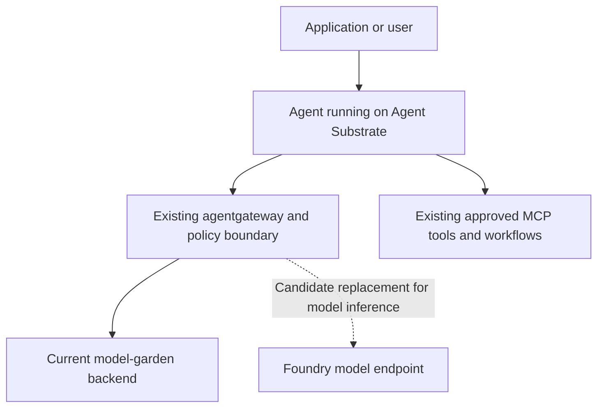

# Microsoft Foundry and the current agent service

Reviewed on 11 November 2026. This is an architecture decision and evaluation guide. It does not report a workplace deployment or authorize a provider cutover.

## Decision

**Do not integrate Foundry hosted agents into the current Agent Substrate hosting path.** Foundry hosted agents do not work as a drop-in runtime or worker backend for our Agent Substrate deployment. They run agent code on Microsoft's managed infrastructure, with a separate deployment and session lifecycle. Adopting that hosting product would mean moving agent execution to another hosting service. We therefore do not currently plan to integrate it.

**Foundry model endpoints remain a possible replacement for the existing model garden.** They supply inference to agents that continue running on our infrastructure. Replacing the model-garden backend does not require replacing Agent Substrate.

These are different products and decisions.

| Option | What it changes | Position for the current service |
| --- | --- | --- |
| Foundry hosted agents | Agent execution, hosting, identity, and session lifecycle | Do not pursue as an integration with the existing Substrate runtime. |
| Foundry model endpoints | Model inference provider behind the existing service | Evaluate only as an alternative to the current model garden. |

The hosting conclusion is specific to our runtime integration. A separately hosted agent could still communicate with other services over an API. That is a different architecture, not a native Substrate integration. The reviewed Microsoft documentation does not establish that Foundry's internal hosting implementation uses Agent Substrate. See the [hosted-agent documentation](https://learn.microsoft.com/en-us/azure/foundry/agents/concepts/hosted-agents).

## Connect model inference to the current service

The service owner identifies an existing model garden as the current inference backend. This public guide uses that generic name and assumes no vendor-specific API or internal address. The diagrams describe the intended service boundary, not a live topology capture.

The proposed connection retains agentgateway as the provider boundary, following this repository's [gateway architecture](../../platform/agentgateway/README.md).

The dashed route is an evaluation proposal. It is not an automatic fallback and is not configured by this README. Its purpose is to compare providers before any replacement decision.

The target is to preserve the agent-facing model URL and authentication contract where compatible. The gateway would translate or route requests to the selected Foundry deployment. If the current client uses capabilities that the selected endpoint does not support, an adapter or client change is required. Changing a base URL alone does not prove compatibility.

| Service component | Intended treatment |
| --- | --- |
| Agent Substrate, worker pools, and session persistence | Retain the current hosting path. |
| Agent instructions and orchestration | Retain initially, then evaluate behavior with the candidate model. |
| MCP tools, execution permissions, and workflow approvals | Retain the existing access boundaries. |
| Agent-facing gateway route | Preserve where the API contract allows it. |
| Gateway model backend | Replace the model-garden target with a reviewed Foundry target after acceptance. |
| Provider authentication, model names, limits, and billing | Configure for the selected Azure deployment. |

The repository's [Azure OpenAI backend](../../platform/agentgateway/backend-azure-openai.yaml) is a starting pattern, not a ready-to-apply Foundry manifest. Validate it against the installed agentgateway CRD and runtime. Do not copy its API version, authentication shape, or deployment name without checking the selected endpoint.

## What must be configured

Keep environment values in the internal delivery configuration.

| Configuration | Value to establish |
| --- | --- |
| Azure ownership | Subscription, resource group, service owner, and billing owner. |
| Inference target | `{{FOUNDRY_MODEL_BASE_URL}}` and `{{FOUNDRY_DEPLOYMENT_NAME}}`. |
| API contract | Chat Completions or Responses, URL shape, supported parameters, and API version where applicable. |
| Identity | `{{GATEWAY_IDENTITY}}`, its federation, token audience, and least-privilege inference role. |
| Network | Approved private route, private DNS, TLS trust, and required identity-service connectivity. |
| Gateway policy | Model mapping, allowed callers, timeouts, bounded retries, rate limits, and usage attribution. |
| Acceptance | Quality, tool accuracy, latency, token usage, cost, and rollback criteria. |

Choose the endpoint for the selected model and client. A project endpoint, a model inference endpoint, and a hosted-agent endpoint serve different purposes. Do not configure a hosted-agent URL as the model backend. Microsoft's [SDK and endpoint guide](https://learn.microsoft.com/en-us/azure/foundry/how-to/develop/sdk-overview) describes the API choices.

Keep caller-to-gateway authentication separate from gateway-to-provider authentication. Foundry hosted agents' automatically created identities are not supplied to our self-hosted actors or gateway. The existing gateway identity path needs its own reviewed Azure grants.

## Model choice and payment

Foundry is not limited to OpenAI. Its catalog includes Azure OpenAI and selected models from other providers. The catalog currently lists GPT-6 and GPT-6.1 models, but this does not establish availability, quota, or approval in our subscription. Select a supported deployment with the required tool-calling and streaming behavior. See the [current catalog](https://learn.microsoft.com/en-us/azure/foundry/foundry-models/concepts/models-sold-directly-by-azure).

For models sold by Azure, usage is billed through the Azure subscription. Compare the selected inference meter and agreement with the current model-garden cost. Pay-as-you-go token charges and provisioned capacity have different cost structures. A resource's region alone does not establish the processing geography of a Global deployment.

The model-endpoint-only design retains our AKS/Substrate infrastructure costs and adds the selected model charges plus any associated network or logging charges. It does not require Foundry hosted-agent compute. That separate hosting product charges for vCPU-hours and GiB-hours. Do not count its runtime in the endpoint-only estimate. See [Foundry Agent Service pricing](https://azure.microsoft.com/en-us/pricing/details/foundry-agent-service/).

## Restricted-network and air-gap implications

An environment with no public internet but approved private Azure connectivity can evaluate Azure inference. A fully disconnected environment cannot call an Azure-hosted model endpoint and needs an internally available model instead.

For a gateway-only provider change, the new requirements are primarily the approved model route, identity, DNS, TLS trust, configuration, and quota. We do not need to import the Foundry hosted-agent server, its Python environment, or another sandbox runtime into every actor. If a new client adapter is necessary, include its locked dependencies in the existing internal build process.

Our existing Substrate installation still needs its own mirrored charts, images, storage dependencies, and architecture-matched runtime assets. In the documented v0.0.9 gVisor path, `runsc` is a separate asset from the worker image. On a cache miss, an internal asset URL alone does not suppress the initial public Google Storage attempt. The version-specific [Substrate air-gap guide](../../work-agent-bundles/agent-substrate/AIRGAPPED-AKS-README.md) describes pre-seeding `atelet`'s cache to avoid that download. Verify the installed version and asset availability on every eligible target node. Foundry model access does not remove those existing dependencies.

If hosted agents are reconsidered later, assess that hosting path separately. Source deployment can restore packages remotely or accept bundled Linux dependencies; it is not an offline installation of Foundry. The current documentation lists additional service endpoints. Hosted-agent VNet injection must be configured when creating the Foundry account. See [source-deployment dependencies](https://learn.microsoft.com/en-us/azure/foundry/agents/how-to/deploy-hosted-agent-code) and [private networking](https://learn.microsoft.com/en-us/azure/foundry/agents/how-to/virtual-networks).

## Evaluate a replacement before changing the default

1. Read back the current route, provider contract, installed gateway version, and model-garden responsibilities. Identify any guardrails, routing, usage accounting, or other capabilities beyond inference that a replacement must preserve.
2. Confirm the target Azure subscription, model deployment, quota, permitted processing geography, network path, and billing owner.
3. Prepare a separate lower-environment candidate backend through the existing GitOps delivery process. Keep the current model garden as the unchanged baseline.
4. Verify identity and connectivity from the actual gateway execution context. A developer's successful login is not gateway authentication proof.
5. Run representative agent tasks through both providers. Check streaming, cancellation, structured output, tool arguments, errors, retries, and any required embedding models. Compare complete-task quality, latency, tokens, and cost.
6. Prove a Substrate-hosted agent can complete an approved read-only tool workflow through the candidate route. Retest its session lifecycle if the runtime image or client state handling changes.
7. Review the results and a rollback plan. Only then request the normal approval to replace the default model-garden backend and promote the GitOps change.

No production fallback, new tool permissions, or live provider replacement is implied by this evaluation plan.

## Evidence boundary

This README combines current Microsoft documentation, repository gateway patterns, and the service owner's stated model-garden boundary. It has not inspected the workplace cluster, identity assignments, live model route, quota, or bills.

The earlier local Foundry Basic sample started and returned HTTP 200 from its readiness endpoint using placeholder model settings. That proves local server startup only. It does not prove model access, hosted-agent deployment, compatibility with this service, cost savings, or an air-gapped deployment.

**The current position is to retain Agent Substrate, decline the Foundry hosted-agent integration, and consider Foundry inference only if replacing the existing model garden has a demonstrated benefit.**
