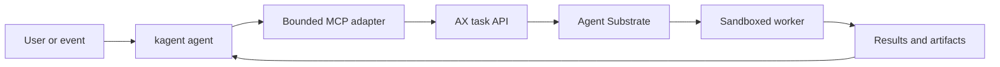

# Google AX, kagent, and Agent Substrate

Quick reference reviewed on **29 October 2026** against upstream documentation.
This compares AX with the current **kagent 1.x architecture**, not older kagent
Deployment-based installations. No cluster coexistence test was performed.

**AX and kagent can complement each other, but their responsibilities overlap.**
Both use Agent Substrate to execute sandboxed agents. AX is not a replacement
for Substrate, and kagent does not need AX to use Substrate.
[Substrate lists both as ecosystem clients.](https://github.com/agent-substrate/substrate#ecosystem--examples)

## Comparison

| Area | Google AX | kagent 1.x with Substrate |
|---|---|---|
| Main abstraction | A task with an image, command, and prepared workspace | An agent with behaviour, runtime configuration, and conversational sessions |
| Configuration | `Task`, `Workspace`, `Model` | `Agent`, `AgentTemplate`, `Harness`, `ModelConfig`, and MCP resources |
| Interaction | CLI and gRPC task API; sandbox access through `ax ssh` | UI, CLI, A2A invocation, and MCP interfaces |
| Workspace | Declarative Git checkouts, MCP configuration, and skills | Tools, skills, and runtime inputs resolved through agent configuration and harnesses |
| Runtime | Substrate actors | Substrate actors |
| State storage | AX resources in its own PostgreSQL store | Kubernetes desired configuration; PostgreSQL sessions and interaction history |
| Lifecycle | Task creation, suspension, resumption, and deletion | Sessions, idle suspension, checkpoints, forks, and standalone sandboxes |

Sources: [AX concepts](https://github.com/google/ax/blob/main/docs/concepts.md),
[AX architecture](https://github.com/google/ax/blob/main/DESIGN.md),
[kagent overview](https://github.com/kagent-dev/kagent/blob/main/README.md), and
[kagent architecture](https://github.com/kagent-dev/kagent/blob/main/docs/architecture/README.md).

AX's task and workspace model is relevant to coding, investigation, or evaluation
jobs that need a prepared filesystem. Kagent also supports Codex, Claude, custom
runtimes, and standalone sandboxes, so those use cases do not automatically
require AX.

## Relationship to Flux

AX manifests look like Kubernetes YAML, but **AX objects are not Kubernetes CRDs**.
AX stores them in PostgreSQL and exposes its own gRPC API. Flux cannot reconcile
them through its ordinary Kubernetes apply path. A separate integration would
have to submit version-controlled definitions to AX.
[AX storage and API design](https://github.com/google/ax/blob/main/DESIGN.md)

## Proposed integration

The following is a proposed design, not a tested or ready-made bridge.

Kagent would own the conversation and delegation. An MCP adapter would submit
bounded jobs to AX and retrieve their results. AX would own each delegated task's
workspace and sandbox lifecycle. The adapter would need authentication, quotas,
status checks, cancellation, and explicit completion evidence.

Sharing one Substrate installation is an architectural possibility, not a
verified compatibility claim. It requires compatible pinned API versions,
separate ownership of actors and templates, and appropriate atespace isolation.
Shared Substrate does not make AX tasks interchangeable with kagent sessions.
Model and MCP routing through agentgateway would also require explicit
configuration.

## Limits that affect an evaluation

- **Readiness is not task success.** AX currently keeps its runner alive after
  the agent command exits, and its control plane does not read that command's
  exit status. An integration needs explicit result and artifact checks.
- **Resume has a process boundary.** AX's runner contract describes a restored
  workspace with a fresh process tree. Do not assume a running command continues
  unchanged after resume.

Both behaviours are documented in the
[AX runner contract](https://github.com/google/ax/blob/main/docs/runner.md).

AX warns of major breaking changes before a stable release. Its roadmap includes
further work on governance, budgets, telemetry, and automatic idle suspension.
Those roadmap entries are not evidence of complete enforcement today.
[AX status](https://github.com/google/ax#ax) and
[AX roadmap](https://github.com/google/ax/blob/main/docs/roadmap.md)

## Recommendation for this platform

Retain kagent as the agent platform for the AKS, Flux, and Argo solution. Evaluate
AX only against a concrete task or workspace capability missing from the chosen
kagent harness. Keep resource-changing permissions with approved workflows and
their service accounts.

AX retains the Substrate dependency. It does not remove AKS admission, sandbox
runtime, or air-gap requirements. The
[existing air-gapped AKS guidance](../../work-agent-bundles/agent-substrate/AIRGAPPED-AKS-README.md)
records version-specific constraints; it is not a compatibility matrix for AX.

Recheck the upstream contracts and installed versions before implementing the
bridge. Claims about running millions of tasks are upstream design targets, not
benchmarks established by this comparison.
