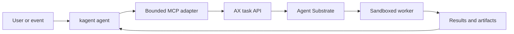
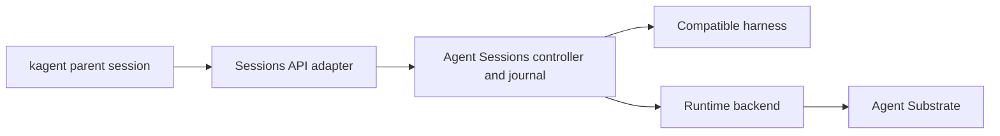

# Google AX, Agent Sessions, kagent, and Agent Substrate

Quick reference reviewed on **29 October 2026** against upstream documentation.
This compares AX and **Agent Sessions (`agentsessions`)** with the current
**kagent 1.x architecture**, not older kagent Deployment-based installations.
No cluster coexistence test was performed.

**AX and kagent can complement each other, but their responsibilities overlap.**
Both use Agent Substrate to execute sandboxed agents. AX is not a replacement
for Substrate, and kagent does not need AX to use Substrate.
[Substrate lists both as ecosystem clients.](https://github.com/agent-substrate/substrate#ecosystem--examples)

Agent Sessions adds a framework-neutral contract for durable execution history,
replay, and forks. It already has a Substrate backend, but can also operate without
Kubernetes. It overlaps most with kagent's session layer.
[Agent Sessions concepts](https://sessions.agent-primitives.dev/concepts/) and
[architecture](https://github.com/agent-primitives/sessions/blob/main/docs/architecture.md)

## Comparison

| Area | Google AX | Agent Sessions | kagent 1.x with Substrate |
|---|---|---|---|
| Main abstraction | Task and prepared workspace | Durable session and typed event journal | Agent, runtime configuration, and conversational sessions |
| Configuration | `Task`, `Workspace`, `Model` | Sessions API, harness contract, and runtime contract | `Agent`, `AgentTemplate`, `Harness`, `ModelConfig`, and MCP resources |
| Interaction | CLI, gRPC task API, and `ax ssh` | CLI and gRPC Sessions API | UI, CLI, A2A invocation, and MCP interfaces |
| Workspace | Git checkouts, MCP configuration, and skills | Supplied by the harness and runtime integration | Tools, skills, and runtime inputs resolved through agent configuration and harnesses |
| Runtime | Substrate actors | Pluggable local, remote, and Substrate backends | Substrate actors |
| State storage | AX resources in PostgreSQL | Append-only, hash-chained event journal; SQLite reference store | Kubernetes desired configuration; PostgreSQL sessions and interaction history |
| Lifecycle | Task creation, suspension, resumption, and deletion | Execute, suspend, resume, fork, and replay; deletion records intent only | Sessions, idle suspension, checkpoints, forks, and standalone sandboxes |
| Distinctive emphasis | Prepared execution tasks | Recorded-effect replay and independently verifiable history | Kubernetes agent management and A2A interactions |

Sources: [AX concepts](https://github.com/google/ax/blob/main/docs/concepts.md),
[AX architecture](https://github.com/google/ax/blob/main/DESIGN.md),
[kagent overview](https://github.com/kagent-dev/kagent/blob/main/README.md), and
[kagent architecture](https://github.com/kagent-dev/kagent/blob/main/docs/architecture/README.md).
Agent Sessions details come from its
[architecture](https://github.com/agent-primitives/sessions/blob/main/docs/architecture.md) and
[FAQ](https://github.com/agent-primitives/sessions/blob/main/docs/faq.md).

AX's task and workspace model is relevant to coding, investigation, or evaluation
jobs that need a prepared filesystem. Kagent also supports Codex, Claude, custom
runtimes, and standalone sandboxes, so those use cases do not automatically
require AX.

## Relationship to Flux

AX manifests look like Kubernetes YAML, but **AX objects are not Kubernetes CRDs**.
AX stores them in PostgreSQL and exposes its own gRPC API. Flux cannot reconcile
them through its ordinary Kubernetes apply path. A separate integration would
have to submit version-controlled definitions to AX.
[AX storage and API design](https://github.com/google/ax/blob/main/DESIGN.md)

## Proposed integration

The following is a proposed design, not a tested or ready-made bridge.

Kagent would own the conversation and delegation. An MCP adapter would submit
bounded jobs to AX and retrieve their results. AX would own each delegated task's
workspace and sandbox lifecycle. The adapter would need authentication, quotas,
status checks, cancellation, and explicit completion evidence.

Sharing one Substrate installation is an architectural possibility, not a
verified compatibility claim. It requires compatible pinned API versions,
separate ownership of actors and templates, and appropriate atespace isolation.
Shared Substrate does not make AX tasks interchangeable with kagent sessions.
Model and MCP routing through agentgateway would also require explicit
configuration.

## Where Agent Sessions fits

Substrate owns isolated compute and snapshots. AX owns tasks and workspaces.
Agent Sessions owns a durable session contract. Kagent combines agent definitions,
invocation, and session orchestration. These are overlapping responsibilities,
not four mandatory layers in one stack.

Agent Sessions' distinction is how it records and reconstructs execution:

- A single writer appends typed events using compare-and-swap and fencing tokens.
- Replay serves recorded model and tool results instead of performing those
  effects again. Fresh continuation can still call models and execute tools.
- `STATELESS_REPLAY` reconstructs harness state from the journal without requiring
  RAM snapshots. `REQUIRES_MEMORY_SNAPSHOT` requires a backend that restores RAM.
- Replay-based forks can branch at historical journal positions. Memory-based
  forks checkpoint the parent at its current state and restore each child.

These guarantees require a compatible harness that routes nondeterministic
effects through the Sessions contract. Wrapping an arbitrary existing kagent or
AX process does not automatically make its internal execution replayable.
External tool effects still need durable idempotency in their executor.
[Concepts](https://sessions.agent-primitives.dev/concepts/) and
[recovery and fork semantics](https://github.com/agent-primitives/sessions/blob/main/docs/faq.md)

A separate proposed delegation path would be:

Kagent would retain the parent interaction. Agent Sessions would own the delegated
session's journal and recovery. An adapter would map identity, inputs, results,
approvals, and errors. No ready-made kagent bridge was established by this review.
AX is optional in this path. Using AX to provision the same compute would require
another runtime adapter and a clear single owner for suspension, forks, and cleanup.

The upstream project documents real Substrate conformance for both resumability
tiers. That is upstream evidence, not a test of this platform or the proposed
kagent integration.
[Substrate verification scope](https://github.com/agent-primitives/sessions/blob/main/docs/substrate-conformance.md)

### Agent Sessions evaluation limits

- The reference daemon has no built-in caller authentication, authorization, or
  transport security. Custom Go hosts have optional hooks; this is not a complete
  enterprise isolation solution. A `project` value is a listing filter, not a
  tenancy boundary.
- The hash chain detects inconsistent edits. Tail truncation or a complete rewrite
  needs external anchoring to detect; the chain is not a signature or proof that
  the recorded agent answer was correct.
- `DeleteSession` records a permanent tombstone and returns `PENDING`; it does not
  reclaim actors, snapshots, or fork pins. `Cancel` remains unimplemented.
- The API is pre-1.0. Replay, fork, and memory restoration have different costs and
  guarantees; neither zero-cost forks nor exactly-once external actions follow
  from the journal alone.

Sources: [security posture](https://github.com/agent-primitives/sessions/blob/main/docs/security.md),
[lifecycle limits](https://github.com/agent-primitives/sessions/blob/main/docs/faq.md), and
[API stability](https://github.com/agent-primitives/sessions#api-stability).

## AX evaluation limits

- **Readiness is not task success.** AX currently keeps its runner alive after
  the agent command exits, and its control plane does not read that command's
  exit status. An integration needs explicit result and artifact checks.
- **Resume has a process boundary.** AX's runner contract describes a restored
  workspace with a fresh process tree. Do not assume a running command continues
  unchanged after resume.

Both behaviours are documented in the
[AX runner contract](https://github.com/google/ax/blob/main/docs/runner.md).

AX warns of major breaking changes before a stable release. Its roadmap includes
further work on governance, budgets, telemetry, and automatic idle suspension.
Those roadmap entries are not evidence of complete enforcement today.
[AX status](https://github.com/google/ax#ax) and
[AX roadmap](https://github.com/google/ax/blob/main/docs/roadmap.md)

## Recommendation for this platform

Retain kagent as the agent platform for the AKS, Flux, and Argo solution. Evaluate
AX only against a concrete task or workspace capability missing from the chosen
kagent harness. Keep resource-changing permissions with approved workflows and
their service accounts.

Agent Sessions is worth a separate bounded evaluation if portable replay,
failure recovery, or verifiable branch history is a concrete requirement. Its
session contract is relevant to that question; it does not replace Kubernetes
agent management or Substrate isolation. No AX or Sessions integration is needed
merely to add another kagent agent.

AX retains the Substrate dependency. It does not remove AKS admission, sandbox
runtime, or air-gap requirements. The
[existing air-gapped AKS guidance](../../work-agent-bundles/agent-substrate/AIRGAPPED-AKS-README.md)
records version-specific constraints; it is not a compatibility matrix for AX.

Recheck the upstream contracts and installed versions before implementing the
bridge. Claims about running millions of tasks are upstream design targets, not
benchmarks established by this comparison.
