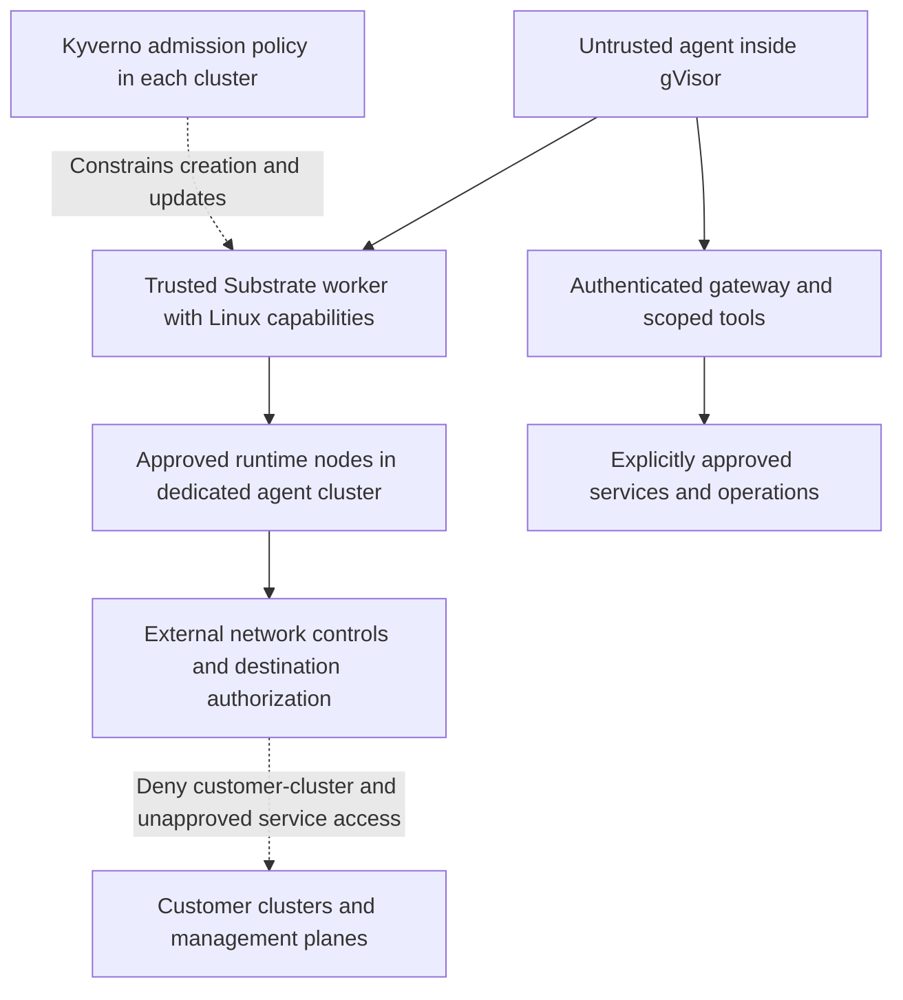

# Agent Substrate permissions and blast radius

Security discussion draft. Source review updated 4 November 2026. The proposed target is one dedicated engineering agent cluster. Workplace configuration, enforcement, and approval remain unverified.

## The agent does not receive the runtime's administrator permission

**The requested `SYS_ADMIN` capability belongs to the trusted Substrate runtime worker that creates the sandbox. It is not a grant of host administrator permission to the AI agent running inside that sandbox.** The worker needs elevated Linux operations to construct the isolation boundary. The agent consumes that isolation as an untrusted workload.

There are three separate kinds of authority:

| Authority | Holder and purpose | What the agent receives |
| --- | --- | --- |
| Linux runtime capabilities, including `SYS_ADMIN` | The outer Substrate worker sets up mounts, namespaces, networking, and sandbox lifecycle. | Execution inside its own sandbox. The worker's host capabilities are not automatically delegated to the agent. |
| Kubernetes and Azure permissions | Service accounts, node identities, controllers, and approved executors receive explicitly scoped roles. | Only separately configured access. A Linux capability does not create a Kubernetes role or an Azure role. |
| Tool and service credentials | A gateway or MCP service can hold credentials and authenticate authorized operations outside the sandbox. | The ability to request specifically authorized operations. Possession of the backing credential is unnecessary, but each requested operation still needs authorization. |

`SYS_ADMIN` is a kernel permission attached to a process, not a password or a reusable API key. Root inside a gVisor sandbox is also distinct from root on the node. gVisor virtualizes the application's system interface and limits access to host resources. Ordinary agent execution should never require an operator to put the agent process directly in the outer worker or run model-generated commands there. Source background is at https://gvisor.dev/docs/architecture_guide/security/ and https://man7.org/linux/man-pages/man7/capabilities.7.html.

Keeping a credential outside the sandbox reduces credential theft risk. It does not make the credential's permitted actions harmless. A compromised agent that can request an authorized destructive operation can cause damage without stealing a key or escaping the sandbox. Tool servers must check the caller, operation, destination, resource scope, and any required approval.

The security team's concern is therefore valid, but needs a precise subject. The elevated component is trusted runtime infrastructure. Its permissions increase the consequences **if that infrastructure is compromised**. They do not mean the model has unrestricted host administration during normal operation.

## What the dedicated cluster buys us

The proposed design puts Substrate in its own engineering cluster, outside the customer workload clusters. This removes customer application Pods, their volumes, and their Kubernetes control plane from the agent runtime's immediate host environment. That is a substantial reduction in direct exposure. Microsoft's cluster-isolation guidance distinguishes cluster separation from logical isolation within a shared cluster at https://learn.microsoft.com/en-us/azure/aks/operator-best-practices-cluster-isolation.

The defensible planning assumption is that **the dedicated agent cluster may be lost following a serious runtime or node compromise**. Its rebuild must be acceptable. Node compromise does not automatically grant control of the managed AKS control plane, every namespace, another cluster, or an Azure subscription. Those further outcomes need additional permissions, reachable services, configuration weaknesses, or vulnerabilities. However, the current evidence does not justify promising containment to one actor, one worker, or one node.

The intended outcome is an agent-cluster incident with bounded external exposure. That requires independent controls on networking, identities, storage, tools, and delivery systems. A separate cluster alone does not prove that outcome.

## Which component actually needs what?

The previous local review recorded kagent `1.0.0-alpha17` with Substrate `v0.6.0-alpha3`. This README rechecked source at commit `e2fc0fa9f77ab5fc09eb01b43ccd74bd84c67c71`. The commit is a source reference, not proof that the workplace image contains the same code. Capture the actual image digests, rendered manifests, and runtime assets before approval. Older bundle instructions use `v0.0.9`, whose privileged configuration must be assessed separately.

| Component | Reviewed configuration | Security implication |
| --- | --- | --- |
| Agent actor | Application running inside a gVisor sandbox. Actor security context is separate from the worker's context. | Treat generated code, downloaded dependencies, prompts, and tool responses as untrusted. Verify the actor's actual privileges rather than infer them from the worker Pod. |
| gVisor worker, historically `Deployment/kagent-default`, container `worker`, namespace `kagent` | Runs as UID/GID 0, sets `privileged: false`, drops `ALL`, then adds the runtime capability set below. Explicitly uses `Unconfined` AppArmor and seccomp. | Reduced capability set compared with privileged mode, but still a sensitive trusted component. `privileged: false` is not evidence of a low-risk worker. |
| Worker host storage | Writable `/var/lib/ate` hostPath with `HostToContainer` mount propagation. | An outer-worker compromise can affect shared runtime state exposed through this mount. This is not a mount of the entire host filesystem, and does not itself establish full node control. |
| `DaemonSet/atelet`, namespace `ate-system` | Runs as root, drops `ALL`, adds `DAC_OVERRIDE`, and accesses node paths. The base manifest has no node selector. | Must receive its own placement, identity, host-path, and network review. Restricting only WorkerPools leaves a gap. |
| Gateway, API, controllers, object-store plugin, and identity services | Separate trusted infrastructure, potentially holding broader identities or storage access. | Keep them off the untrusted runtime nodes where supported. Review their permissions and exposure individually. |

The reviewed gVisor worker additions are:

```text
NET_ADMIN SYS_ADMIN SYS_CHROOT SYS_PTRACE
SETUID SETGID SETPCAP DAC_OVERRIDE
FOWNER CHOWN MKNOD NET_RAW SETFCAP
```

`SYS_ADMIN` covers broad operations such as mounts and namespace administration, subject to namespace ownership and other kernel checks. `SYS_PTRACE` is also subject to process visibility and access checks. Neither capability is an unconditional switch that exposes every host process or every disk. The total configuration matters, including user namespaces, mounted paths, devices, sockets, seccomp, AppArmor, and the node kernel.

The reviewed `atelet` manifest also exposes kubelet plugin and device-plugin directories, read-only host-device discovery, and image-credential-provider paths. These are sensitive integration points even though `atelet` does not request `SYS_ADMIN` in this source. Some paths are distribution-specific. Inventory the AKS rendering rather than copy another platform's paths or exceptions.

Source references:

- Worker security context, host mount, and optional placement fields. https://github.com/agent-substrate/substrate/blob/e2fc0fa9f77ab5fc09eb01b43ccd74bd84c67c71/cmd/atecontroller/internal/controllers/workerpool_apply.go
- `atelet` capabilities, RBAC, node integration, and base scheduling. https://github.com/agent-substrate/substrate/blob/e2fc0fa9f77ab5fc09eb01b43ccd74bd84c67c71/manifests/ate-install/atelet.yaml
- Shared node paths and the documented ability of a worker to unlink or replace a shared runtime socket. This is source-identified exposure, not a reproduced exploit. https://github.com/agent-substrate/substrate/blob/e2fc0fa9f77ab5fc09eb01b43ccd74bd84c67c71/internal/nodepath/nodepath.go

## How damage could occur

These are conditional impact scenarios, not claims that an exploit has been demonstrated or estimates of its probability.

| Scenario | What must happen | Possible damage | Boundary that limits it |
| --- | --- | --- | --- |
| Agent misuses an allowed tool | Prompt injection, malicious input, or an incorrect decision causes an authorized call. No escape required. | Delete or change resources, disclose data, create misleading tickets, or generate costs within the tool's authority. | Authorization at the target or tool server, read-only identities, fixed operations, scoped parameters, and a separate approved executor for changes. |
| Agent abuses its normal workspace | Agent executes harmful code inside its sandbox. | Delete its files, corrupt its own state, exhaust its allocation, or transmit data through an allowed destination. | Per-actor storage and resource limits, data minimization, and restricted egress. |
| Agent compromises the outer worker | A sandbox/runtime vulnerability, exposed local service, or unsafe integration crosses the actor boundary. | Interfere with co-hosted actors, runtime mounts, shared caches or sockets, actor traffic, and state reachable by the worker. | Patched runtime, narrow host integration, separate trust groups, limited worker identity, and controls outside the worker. |
| Attacker obtains node root | An additional escape, kernel weakness, or host integration enables node control. | Read local actor state and credentials, tamper with workloads, disrupt the node, steal available identities, and attack reachable services. | Treat the node as lost. External network enforcement, destination authorization, restricted identities, and rebuild procedures bound further damage. |
| Stolen identity accesses shared infrastructure | A reachable service accepts the compromised component's identity. | Read or change snapshots outside that node, corrupt shared state, poison artifacts, or access other clusters if that identity is trusted there. | Dedicated storage and identities, narrow resource scopes, no cross-cluster role bindings, and no production delivery credentials. |
| Agent or attacker exhausts shared services | Actor creation, retries, model calls, downloads, snapshots, or traffic exceed capacity. | Agent-platform outage, storage growth, API throttling, inference charges, or abuse of approved external services. | Actor and worker limits, bounded retries, gateway rate and token limits, storage limits, hard budget controls where supported, and operator shutdown. |
| Compromised state survives replacement | Malicious files or memory state enter a snapshot, image, or cache. | A replacement worker resumes the compromise or publishes poisoned output. | Trusted image provenance, controlled restore, snapshot quarantine, scoped artifact writes, and clean rebuilds. |

The local filesystem boundary deserves attention before node root is considered. The worker already has access to a shared host directory. Full host escape is not a prerequisite for damage to that shared directory. Conversely, access to that directory is not evidence that the attacker can read arbitrary customer disks on other clusters.

The pinned upstream security document explicitly leaves node blast-radius containment unfinished. Its threat model discusses worker, filesystem, local-service, storage-identity, and network attack paths. These support planning for more than one actor's loss. They do not prove a particular exploitable chain in the target environment.

https://github.com/agent-substrate/substrate/blob/e2fc0fa9f77ab5fc09eb01b43ccd74bd84c67c71/docs/security.md

https://github.com/agent-substrate/substrate/blob/e2fc0fa9f77ab5fc09eb01b43ccd74bd84c67c71/docs/threat-model.md

## Why an agent node still contains useful information

The claim "there is no customer database on these nodes" can be true while "there is nothing useful to steal or damage" is false.

| Asset or access path | Why it matters | Proposed restriction |
| --- | --- | --- |
| Prompts, tool results, files, logs, and actor memory | An agent may receive sensitive customer or operational information remotely. Snapshots may preserve that information after execution pauses. | Begin with synthetic or approved sanitized inputs. Define permitted data classes, retention, log redaction, and model-provider handling. |
| Mounted service-account tokens and component certificates | Permit actions as the associated identity. Short lifetime limits duration, but does not prevent use while valid. | Remove unnecessary token mounts, review effective RBAC, and protect issuance and refresh paths. |
| Kubelet credentials | Node authorization permits specific reads, including Secrets associated with bound Pods. It is not unrestricted cluster-admin. | Verify Node authorization and NodeRestriction, avoid sensitive co-resident workloads, and test effective node permissions. |
| Azure managed identities and metadata access | A node-attached identity can obtain tokens for its assigned roles. No stored password is necessary. | Separate identities, minimum Azure role scopes, and metadata restrictions. Workload Identity does not itself remove node identity exposure after node compromise. |
| Snapshot store, state database, registry, and source access | A shared identity can extend impact beyond the currently running actors or node. Registry write access can turn an agent incident into an artifact-supply-chain incident. | Dedicated storage and credentials, read-only image pulls, restricted snapshot prefixes where supported, and no shared production writer credentials. |
| Flux, CI, signing, or deployment authority | A stolen identity may reach a management plane that controls customer systems. | Keep fleet administration, production Git writers, signing keys, and customer deployment credentials outside the agent cluster. Review every privileged DaemonSet. |
| Network position and compute | Even an empty node can be used for scanning, proxying, attacks, or resource abuse. | External segmentation, restricted dependencies, rate limits, and infrastructure capacity limits. |

Kubernetes documents service-account access and node authorization at https://kubernetes.io/docs/concepts/security/service-accounts/ and https://kubernetes.io/docs/reference/access-authn-authz/node/. AKS distinguishes cluster, kubelet, and application identities at https://learn.microsoft.com/en-us/azure/aks/managed-identity-overview.

## The containment design



The arrows describe trust and access paths, not a claim that the agent receives the worker's capabilities. Each layer below is a proposed control requiring target-environment proof.

### 1. One approved cluster, with a narrow workload allowance

Use Kyverno for Kubernetes admission enforcement. Kyverno checks requests to the cluster where it runs. It cannot make another cluster enforce a rule, block an arbitrary network packet, or undo host compromise.

| Location | Required admission result |
| --- | --- |
| Approved cluster, reviewed worker and `atelet` configuration | Permit only the exact approved runtime deviations, identities, images, paths, and placement. |
| Approved cluster, unrelated Pods, including Pods in `kagent` and `ate-system` | Enforce the normal baseline. Namespace membership does not qualify a Pod for the runtime allowance. |
| Every other cluster | No Substrate allowance. Deny these runtime deviations under the baseline, while preserving separately reviewed platform exceptions. |

Deploy the common baseline through protected fleet GitOps. Deliver the Substrate allowance only in the approved cluster's protected overlay. A Pod label, a namespace label, a WorkerPool name, or an editable ConfigMap must not decide whether a cluster is approved. Restrict who can change cluster enrollment, policies, exceptions, webhook filters, namespace security labels, and GitOps reconciliation settings.

The engineering allowance must validate the whole approved shape. Match namespace, container, service account, immutable image digest, command and arguments, exact allowed capability additions with `ALL` dropped, security profiles, host paths and propagation, and required placement. Reject arbitrary extra containers, capabilities, mounts, or argument overrides. Keep privileged mode and host namespace sharing denied unless separately justified. Treat each necessary `atelet` host integration and host port explicitly. Protect runtime asset URLs and checksums as administrator-owned configuration.

A Pod's service account or owner-reference string is not proof that an approved controller created it. Restrict direct Pod creation, service-account use, controller and WorkerPool mutation, binding, impersonation, exec, and ephemeral debugging access. Where admission depends on controller provenance, test the actual authenticated request identity and reconciliation path. A user able to replace the runtime's command while retaining its image has bypassed the intent of the allowance.

Cover main, init, and ephemeral containers, actual Pods generated by controllers, relevant updates and subresources, and applicable custom resources. Audit-only rules and background reports do not block admission. Test webhook fail-closed behavior, resource filters, and existing-violation handling for the installed Kyverno version. A broad `PolicyException` that skips validation needs a separate bounded replacement check.

Kyverno's current documentation covers these mechanisms at https://kyverno.io/docs/policy-types/cluster-policy/validate/, https://kyverno.io/docs/policy-types/cluster-policy/policy-settings/, and https://kyverno.io/docs/guides/exceptions/. Choose the API supported by the installed release. This README defines the policy contract; it does not supply a tested deployable policy.

### 2. Restrict both workers and `atelet` to approved nodes

A Substrate WorkerPool is a pool of worker Pods. It is not an AKS node pool or an independent security domain. Multiple pools may share a node, a writable host directory, or a storage identity.

Use mandatory node selectors or required node affinity for every worker and for `atelet`. Reserve the approved nodes with taints, and limit who can add their tolerations. A toleration alone does not force placement onto those nodes. Preferred affinity is also insufficient. Deny direct `nodeName`, custom scheduling, or binding paths that bypass the approved scheduling contract, except tightly controlled system requirements.

Keep the Substrate control services, credential-holding gateways, and unrelated workloads on separate trusted nodes where the product supports that topology. Inventory unavoidable CNI, CSI, logging, security, and other DaemonSets and their identities. Protected node labels, verified NodeRestriction behavior, and restricted node updates help prevent relabeling from defeating placement. Scheduling rules that are ignored during execution do not evict Pods after label drift, so monitor actual placement too.

The scheduling mechanisms and their limits are documented at https://kubernetes.io/docs/concepts/scheduling-eviction/assign-pod-node/.

### 3. Deny access to customer systems independently of admission

For the initial pilot, allow no customer-cluster access and no customer-system credentials. Any later read-only integration needs an explicit data and access review. Read-only access can still disclose sensitive information.

Use default-deny Pod networking and tightly scoped dependencies, then external subnet, firewall, routing, or equivalent controls that still apply if a worker or node is compromised. Restrict customer API endpoints, customer workloads, management services, metadata paths, and public outbound traffic as appropriate. Verify public endpoints as well as private peering paths. Preserve the platform traffic required for the cluster to function.

Test the actor, outer worker, and node paths separately. Actor egress rules may be enforced inside a worker that an attacker now controls. Standard Kubernetes NetworkPolicy alone does not prove node-level containment. Its scope and node-traffic limitations are documented at https://kubernetes.io/docs/concepts/services-networking/network-policies/.

Customer clusters and services must also refuse the agent cluster's identities. Remove cross-cluster bindings, shared management credentials, broad Azure roles, permissive federation, and overpowered MCP identities. Reachability and authorization are separate gates. A denied network path does not justify leaving a production administrator credential on the node.

### 4. Keep service credentials and write execution outside the actor

Prefer actor-specific identity and brokered credential injection where supported and verified. Do not place raw production credentials in actor environment variables, files, prompts, or snapshots. Protect the gateway that holds credentials and ensure that it authorizes operations, not merely destinations. An allowlisted hostname can host destructive APIs or accept exfiltrated data.

Use fixed, typed, read-only tools for the pilot. Enforce scope and limits inside the tool adapter and at the destination. A prompt saying "read-only" is not authorization. Avoid arbitrary shell, arbitrary SQL, or unrestricted Kubernetes clients backed by a writer identity. Future changes should use a separate executor that checks an approval bound to the exact action, target, parameters, requester, and expiry. The actor must not approve its own request or bypass the executor with another route.

### 5. Bound resource use, persistence, and recovery

Pin worker images and runtime asset hashes, restrict registry writers, scan and patch the node and runtime, and review changes to privileges. Test tailored seccomp, AppArmor, or read-only root-filesystem hardening as separate engineering work. Do not claim that an untested profile is compatible, or that a writable data volume requires an entirely writable container root.

Bound actor concurrency, worker replicas, node autoscaling, CPU, memory, ephemeral storage, snapshot growth, retry loops, and model usage. Kubernetes Pod quotas do not necessarily count logical actors inside an existing worker. Budget alerts notify people; they do not constitute a hard spending ceiling.

Keep security, Kubernetes, identity, gateway, tool, and storage audit records outside the worker's control. Minimize sensitive payloads in those records. Alert on unexpected capability requests, runtime placement drift, policy removal, denied customer access, new identities or bindings, unusual snapshot access, and abnormal model or network usage.

On suspected compromise, the response must stop actor creation and resume, prevent reconciliation from restarting affected workloads, isolate the affected network paths, revoke or block the exposed identities, preserve evidence, quarantine snapshots and caches, and rebuild nodes from trusted sources. Token and role revocation may have propagation delays. Validate actual denial rather than assume instant revocation. Deleting a Pod, removing a policy exception, or restarting a node alone does not complete recovery.

## Evidence that would justify a bounded pilot

All checks below are pending for the workplace. Use synthetic data, isolated fixtures, and separately authorized drills. No exploit attempt, policy deployment, credential use, or cluster mutation was performed for this README.

| Evidence | Required result | Accountable reviewer |
| --- | --- | --- |
| Exact runtime inventory | Rendered Pods, image digests, asset hashes, capability sets, mounts, service accounts, and actor configuration match the reviewed contract. | Platform |
| Cluster enrollment | Only the approved cluster receives the Substrate allowance. Every affected cluster has the required baseline. | Platform and security |
| Admission matrix | Approved shape accepted on engineering. Same shape denied elsewhere. Wrong image, extra capability, altered command, sidecar, host mount, debug container, and spoofed labels denied. | Security |
| Admission failure and bypass checks | Covered requests fail closed when enforcement is unavailable. Unauthorized users cannot edit policies, exceptions, namespaces, protected labels, or create an equivalent runtime directly. | Platform and security |
| Scheduling and replacement | Workers and `atelet` remain on approved nodes after scaling and replacement. Removing all approved capacity leaves workers pending, rather than using other pools. | Platform |
| Actor and component authority | Agent does not possess outer-worker capabilities or raw privileged credentials. Each component's effective Kubernetes and Azure permissions are recorded. | Platform and IAM |
| Network denial | Approved dependencies work. Customer and unapproved endpoints fail from actor, worker, and node test contexts, with evidence from the relevant enforcement point. | Network and security |
| Destination authorization | Direct requests using each reviewed identity fail against customer resources and forbidden tool operations. Checking only the agent UI is insufficient. | IAM and service owners |
| State and storage scope | Synthetic cross-actor and storage-access tests match the approved isolation boundary. Snapshot restore, retention, and quarantine behavior are documented. | Platform and storage |
| Capacity and costs | Concurrency, storage, worker scaling, retries, and model usage have measured limits. Remaining shared-service exposure is explicit. | Platform and service owners |
| Response exercise | Operators can stop resume and reconciliation, block identities, isolate nodes, quarantine persistent state, and rebuild without customer impact. | Operations and security |

For admission tests, retain the denying policy and rule identity. A rejection by Azure Policy or Pod Security Admission does not prove Kyverno's replacement rule works. Admission dry-runs prove only that boundary, not runtime placement, credential safety, or network enforcement. Record versions, time, sanitized results, owners, review expiry, and unresolved exceptions.

## Preserve central policy protection while introducing the allowance

The earlier proposal considered namespace exclusions for two Azure policies, allowed capabilities and read-only root filesystem, in `kagent` and `ate-system`. Prefer limiting any central exception to the approved cluster if the effective assignment design supports that scope. Broad fleet exclusions are not a prerequisite for Substrate.

If the chosen Azure assignment design makes those namespace exclusions apply across multiple clusters, they remove those checks for every matching workload in those namespaces. First prove an equivalent Kyverno baseline on every affected cluster, including those namespaces. Only then change the central exclusions through the authorized policy process. Install the bounded runtime allowance solely on the approved cluster. Unknown cluster coverage is a protection gap, not an acceptable assumption.

Preserve all unrelated Azure policies and Pod Security controls. A new denial needs its own review. This README does not approve additional host-path, profile, host-port, privileged-mode, or namespace exemptions. Expiry must include stopping or replacing existing exceptional workloads because admission changes do not revoke permissions already held by a running process.

The earlier published review is available at https://github.com/davidmarkgardiner/kagent-public/blob/704e373e53e651a1b97d49cb46809296d44634ca/docs/security/agent-substrate-sys-admin-security-review.md. It records historical source and lab context, not current workplace enforcement.

## Suggested wording for the security discussion

> We are requesting elevated Linux permissions for the trusted Substrate runtime that constructs the sandbox. We are not granting the AI agent host administrator permission, Kubernetes cluster-admin, or an Azure administrator role. The agent remains an untrusted application inside that sandbox. Service credentials can remain outside the actor, with every tool operation separately authorized.
>
> The runtime is still security-sensitive. We propose to run it only on approved nodes in one dedicated engineering cluster, with a narrowly enforced Kyverno allowance there and no Substrate allowance on customer or other clusters. We will also enforce network and identity restrictions independently, because admission policy alone cannot contain a compromised node.
>
> Our initial pilot will use approved sanitized data and have no customer-cluster access or production write authority. We will provide admission, placement, network, permission, storage, resource-limit, and recovery evidence. We accept possible loss of the agent cluster as a residual risk. We are asking reviewers to assess that bounded design and its evidence, rather than assume either unrestricted agent administration or zero risk.

Approval would apply only to the reviewed cluster, node pools, runtime digests, actor configuration, data classes, identities, dependencies, and pilot period. Adding customer data, production tools, broader roles, a new runtime backend, or another cluster changes the assessment.
