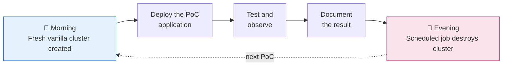
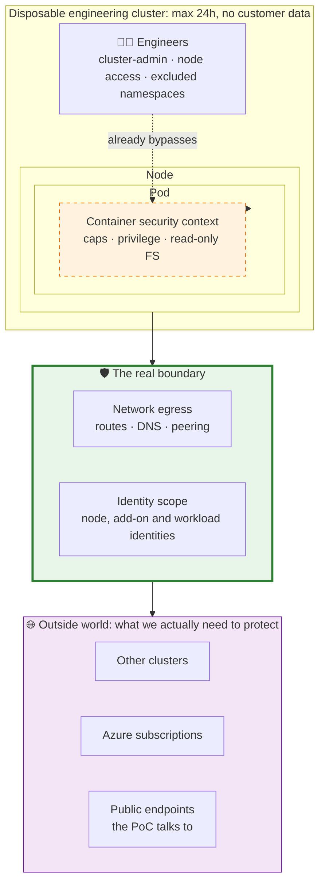
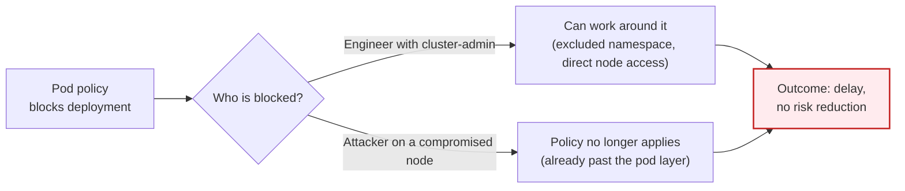
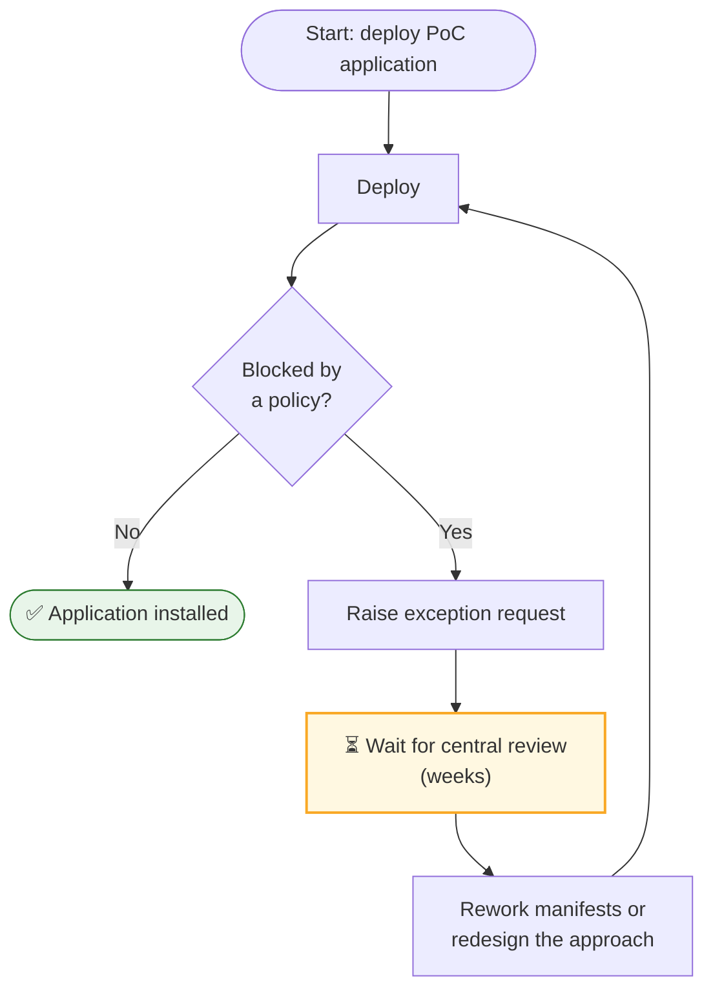
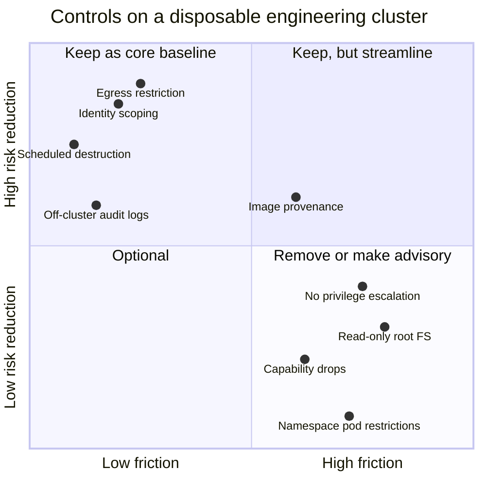
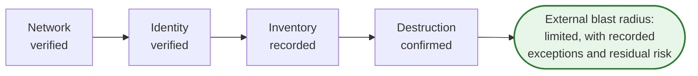

# Disposable engineering cluster: node compromise and external risk

> [!IMPORTANT]
> **The short version**
>
> - The engineering cluster lasts **one working day at most**, holds **no customer workloads or data**, and is **destroyed every evening**.
> - The engineers who use it already have **cluster-admin**, **node-level access** and the ability to deploy into **policy-excluded namespaces**. Pod-level policies do not restrict the people they are meant to restrict. They only slow down legitimate work.
> - The boundary that protects anything outside the cluster is **network egress and identity scope**. Container security settings do not provide that boundary.
> - **Ask:** replace the blanket pod policies on this cluster with an engineering baseline built on the controls that do limit blast radius (network, identity, lifecycle), and verify those controls with evidence.

---

## 1. What the environment is

| Property | Value |
|---|---|
| Purpose | Short proofs of concept: deploy an application, test it, document the result |
| Lifetime | 24 hours or less. Created each morning, destroyed by a scheduled job each evening |
| Workloads | Engineering team only. No customer workloads, no customer data |
| Access controls | RBAC and network controls already in place |
| External connectivity | No private connected systems by default. Any external endpoints are publicly exposed |
| Who has access | The engineering team, which already holds cluster-admin and node access |

> These are design inputs. Section 6 lists the evidence that confirms each one for a given deployment.

---

## 2. Where the security boundary is

Assume the worst: **someone has compromised a node**. What can they reach?

Container settings (dropped capabilities, no privilege escalation, read-only root filesystem) sit *inside* the node. Once the node is compromised they no longer constrain anything. Only the outer layers, network and identity, decide whether the compromise can spread beyond this cluster.

Key points:

- **Node access does not automatically mean access to anything else.** External impact depends on what the node and its workloads can reach, and what their identities can do.
- **Public endpoints still count.** If a credential on the cluster can *change* a public service, that is external impact.
- **AKS system components exist before the PoC is installed.** Inventory them and their access. Do not assume the PoC is the only workload.
- **No customer data lowers the impact. It does not remove it.** Engineering credentials, images and results still have value.

---

## 3. Why the current pod policies do not hold here

Pod policies make sense on shared clusters running customer workloads. On this cluster they are aimed at people who already hold more power than the policies take away.

| Policy area | What it is meant to stop | Why it doesn't stop it here |
|---|---|---|
| Privileged containers, host access | A pod breaking out to the node | Engineers already have node-level access |
| Dropped capabilities, no privilege escalation | A process gaining extra rights | Cluster-admin can grant any right directly |
| Read-only root filesystem | Tampering inside the container | Engineers can deploy to excluded namespaces. Mounted volumes stay writable anyway |
| Namespace-scoped restrictions | Workloads escaping their namespace | Policy-excluded namespaces are available to the same team |
| All of the above | A compromised node reaching the outside world | **None of them address this.** Network and identity controls do |

We still have to trust engineers not to misuse access they already hold. That trust exists today. The policies do not replace it.

---

## 4. What the current process costs

Each blocker only shows up once the one before it is cleared. A single application can go round this loop many times.

**Observed impact:**

- Several engineers spend **months** to get one application installed.
- The work repeatedly goes **back to the drawing board** as each new blocker surfaces.
- The cluster itself is deleted every evening, but the exception process can outlast it many times over.

---

## 5. Which controls earn their place on this cluster

A qualitative view of each control's risk reduction *in this environment* against the friction it causes.

**Proposed engineering baseline:**

| Keep and verify | Make advisory (audit, don't block) |
|---|---|
| Network egress limits and no private connectivity | Read-only root filesystem |
| Tightly scoped node, add-on and workload identities | Capability drops / no privilege escalation |
| Enforced 24-hour destruction with failure alerting | Namespace-scoped pod restrictions |
| Off-cluster audit logs | Other pod-level security context rules |

> Container hardening still has value as defence in depth, which is why the proposal is **audit mode** rather than removal. Agree the baseline, or a time-limited exception, with the policy owners. Do not assume every restriction can safely go, or that any alternative control is automatically equivalent.

---

## 6. Evidence needed before claiming containment

Record the cluster and subscription scope, owner, creation and destruction times, and the approved PoC workload. Then, for each run or through a verified repeatable baseline:

| Area | What to verify | Done |
|---|---|:---:|
| 🌐 **Network** | Node and pod routes, DNS, egress, private links, peering, proxies, reachable services. Confirm node-level traffic is inside the intended boundary | ☐ |
| 🪪 **Identity & RBAC** | Node, cluster, add-on and workload identities and any credentials they can reach. Check their real Azure and Kubernetes permissions. Confirm no unintended access to other environments | ☐ |
| 📦 **Inventory** | Nodes, system and add-on workloads, mounts, secrets, external dependencies, and public services an available credential could change | ☐ |
| ⏱️ **Lifecycle** | Destruction job owner, execution record, failure alert, fallback. Check that deletion actually happened and what was left behind. A schedule is not proof of destruction. Enforce the 24-hour limit with a defined response when deletion fails | ☐ |
| ♻️ **Recovery** | Separately managed identities, role assignments, credentials, logs and resources that survive cluster deletion. Revoke or clean up as appropriate | ☐ |

---

## 7. Residual risk, stated honestly

- **Short lifetime limits exposure time. It does not prevent compromise during the working day.**
- **Deletion cannot undo** external changes or data disclosure that already happened.
- **Limited is not zero.** If the boundary checks pass, the expected external blast radius is limited, subject to the recorded exceptions.
- Keep the off-cluster evidence needed to investigate a compromise and to confirm destruction, without retaining unnecessary sensitive data.

---

## 8. Decision requested

1. Agree that pod-level policies on this cluster move to **audit mode**, because they do not constrain the people or the threat they are aimed at here.
2. Agree the **engineering baseline** in section 5 as the enforced controls.
3. Agree the **evidence checklist** in section 6 as the condition for running the cluster.

Related documents:

- [Engineering policy Teams draft](engineering-policy-blocker-teams-message.md): the decision request and the comparison with deploying applications onto Linux servers
- [Option 1: temporary exception on existing dev/engineering clusters](dev-engineering-policy-exception.md)
- [Option 2: dedicated engineering management group](engineering-management-group-option.md)
