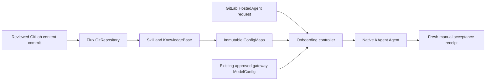

# Four-CRD GitLab handoff

For the backend-first private installation with local owner files, start with [AIRGAP-INSTALL.md](AIRGAP-INSTALL.md), [build/README.md](build/README.md), and [VSCODE-AGENT-AUTHORING.md](VSCODE-AGENT-AUTHORING.md). `private_install.py` is an opt-in offline renderer. It does not deploy or establish workplace security or air-gap closure. The original GitOps path below remains available.

For the workplace requirement to run without Substrate, start with
[NO-SUBSTRATE-WORK-AGENT-PROMPT.md](NO-SUBSTRATE-WORK-AGENT-PROMPT.md).
This package generates ordinary `kagent.dev/v1alpha2` Agents and has no Substrate
dependency. Its tested runtime is kagent 0.7.13. The optional [ordinary MCP demo](ORDINARY-MCP-DEMO.md) has a passing live lab request covering skill, knowledge, one fixed read-only MCP operation, the approved model route and received telemetry. Workplace compatibility and deployment still require target verification. The newer `api.kagent.dev/v1alpha3` native demo is a separate Substrate-backed path.
See [the 22 October readiness review](READINESS-REVIEW-2026-10-22.md) for Claude/Kimi findings, retained failure evidence and current gates.

This self-contained package reproduces the AKS documentation demo through an existing Flux installation. It contains the controller source, four CRDs, Microsoft AKS skill, a cited knowledge article, a local renderer, acceptance runners and historical Proxmox evidence. Nothing has been pushed to GitLab or deployed to a workplace cluster by this package.

Start a work agent with [FRONT-SHEET.md](FRONT-SHEET.md) and the no-Substrate prompt. [WORK-AGENT-PROMPT.md](WORK-AGENT-PROMPT.md) retains the original documentation-only handoff. Read [DESIGN.md](DESIGN.md) for the ownership boundaries and design review.

For a presentation using local files, follow [PRESENTER-WALKTHROUGH.md](PRESENTER-WALKTHROUGH.md). It includes frontend and panel commands, a demo prompt, local HostedAgent submission, and the remaining live-rehearsal boundaries.

The [general read-only MCP grant proposal](tool-grants-design/README.md) remains design-only. The implemented optional demo instead provides one fixed platform-profile capability, with `toolGrantRefs: []`; it does not implement a general ToolGrant catalog.

| API | Purpose | Runtime behavior |
| --- | --- | --- |
| `Skill` | Pin reviewed Git content and file hashes | Content adapter creates an immutable ConfigMap for native `/skills` discovery |
| `KnowledgeBase` | Pin a small set of reviewed, cited Markdown documents | Same adapter creates a separate immutable ConfigMap mounted at `/knowledge`; direct reading, no vector retrieval |
| `HostedAgent` | Request the approved documentation agent profile | Separate onboarding controller creates the account, ingress policy and native KAgent Agent with both mounts |
| `GoldenScenario` | Declare a synthetic AKS acceptance case | Manual runner captures a fresh native skill invocation and emits a receipt; no reconciler or schedule |

The onboarding **golden path** is the sequence below. `GoldenScenario` is its acceptance contract, not a general workflow engine.



The default profile supports one named AKS skill and one article, the existing gateway ModelConfig, and `toolGrantRefs: []`. The optional ordinary profile adds exactly one pinned synthetic-status MCP capability; see ORDINARY-MCP-DEMO.md. Arbitrary BYO container images, operational MCP grants, tool catalog onboarding and sandbox execution remain future work. The native plugin exposes more tools than these tests permit: instructions and retrospective trace checks are not runtime permission enforcement. The generated account has no operational RoleBinding; KAgent may still project its own audience token and supply model credentials.

## Verify the package locally

Use Python 3.12, `kubectl` with local Kustomize support, and the versions in `requirements.txt`. Runtime controllers use the standard library only. Fresh acceptance also needs Bash, `jq`, `curl`, a configured Kubernetes context and Python dependencies.

```bash
python3 -m venv /tmp/four-crds-venv
source /tmp/four-crds-venv/bin/activate
pip install -r requirements.txt
python -B verify.py
```

For the public-safety scan, run `implementation/scripts/public-safe-scan.sh . --allowlist scan-allowlist.txt --json`. The sole exclusion is the unchanged, hash-locked scanner itself, whose detection string otherwise matches its own source.

`verify.py` checks `snapshot.lock.json` then runs the content, GoldenScenario, knowledge, HostedAgent and packaging tests. It performs local Kustomize builds and no cluster requests. The source/helper tree under `implementation/` preserves runner-relative paths. Original lab JSON/YAML and the single native trace fixture there are test inputs; deploy only newly rendered `gitops/` manifests. Historical receipts live separately under `evidence/historical-proxmox/`.

## Target prerequisites and configuration

Compatibility evidence is KAgent **v0.7.13**, Flux **v2.6.4** and Kubernetes **v1.31.14** from Proxmox. These are historical tested versions, not workplace upgrade recommendations. Verify the actual target CRDs, controller and Python runtime before applying: native skills discovery, `deployment.imageRegistry`, read-only projected volumes, custom account ownership and A2A behavior must match. The renderer does not install Flux or upgrade KAgent.

Copy `config.example.json` outside this public package. Replace every `{{PLACEHOLDER}}`; the renderer rejects missing/unknown keys and unresolved placeholders. Keep real configuration and generated private endpoints outside this public repository.

| Fields | Required meaning |
| --- | --- |
| `namespace` | Dedicated, approved application namespace; existing unrelated objects with the same names are a collision |
| `fluxNamespace`, `fluxServiceAccount` | Existing Flux namespace and Kustomize-controller account; controllers must watch the application namespace |
| `platformServiceAccount` | Existing operator-owned Flux reconciliation account **in the Flux namespace**, permitted to manage these CRDs and namespaced controllers/RBAC, including Kubernetes bind/escalation checks |
| `kagentNamespace` | Existing KAgent controller namespace; used for ingress and passed explicitly to acceptance runners |
| `artifactOrigin` | Exact approved source-controller HTTP(S) scheme/host/effective port, independent of application namespace; no credentials, redirects, proxies or URL query |
| `controllerImage` | Approved Python 3.12-compatible image at `@sha256:…`; both controllers use it |
| `expectedRuntimeImage` | Exact native Agent Pod image reference expected on the target; Hosted acceptance checks it and records observed `imageID` |
| `imageRegistry` | Approved native runtime registry prefix compatible with installed KAgent; runtime repository/tag are controller-owned, not arbitrary image overrides |
| `modelConfig`, `modelSpecSha256` | Existing ModelConfig **in application namespace**, routed through approved agentgateway; lowercase SHA256 of its canonical spec |
| `nodeSelector` | Approved workload selector, or `{}` for ordinary schedulable workers; no control-plane selector/tolerations are generated |
| `contentURL`, `contentCommit`, `contentSecret` | Dedicated bounded HTTPS GitLab content repository, reviewed full lowercase SHA1 commit, and same-namespace Secret reference or `null` for public access |
| `gitopsURL`, `gitopsSecret` | HTTPS GitLab manifest repository and Secret reference or `null`; commit is supplied separately after reviewing the seed |

Provision Git credentials through the existing secret-management process. The content credential belongs in the application namespace. The GitOps credential must exist in **both Flux and application namespaces**, because each has a GitRepository. Existing source-controller access to those sources/credentials and Kustomize-controller impersonation must be supported by the platform. The package grants only namespaced impersonation of its three request accounts; it grants no controller-wide Secret access.

The approved ModelConfig must already exist. Compute its fingerprint without reading Secret objects:

```bash
kubectl --context "$TARGET_CONTEXT" -n "$APP_NAMESPACE" get modelconfig "$MODEL_CONFIG" -o json \
  | python3 -c 'import hashlib,json,sys; s=json.load(sys.stdin)["spec"]; print(hashlib.sha256(json.dumps(s,sort_keys=True,separators=(",",":")).encode()).hexdigest())'
```

Verify target namespace onboarding/RBAC, CNI enforcement and existing ingress/egress policies. Adapter traffic needs the Kubernetes API and the exact source-controller origin; the native Agent needs the approved model gateway and KAgent front door. A new ingress policy cannot override broader permits from another policy.

## Three local build stages

The commands below create reviewable files only. Importing commits into GitLab and applying bootstrap manifests require the target environment's authorization and delivery process.

1. Export and review the content seed:

   ```bash
   python3 -B package.py content --output /tmp/agent-content-seed
   ```

   Import **the contents** of that directory into a dedicated GitLab content repository. Preserve the skill MIT licence, frontmatter normalization provenance and original source references. Obtain the reviewed full content commit and set `contentCommit`. Do not use an arbitrary monorepo: the adapter bounds the **whole Flux artifact** at 2 MiB compressed / 8 MiB expanded, with 16 selected files and 128 KiB selected UTF-8 content. `.git` is not part of Flux's archive; unrelated repository files still count.

2. Render configured GitOps manifests and manual acceptance:

   ```bash
   python3 -B package.py render --config /secure/path/workplace.json --output /tmp/agent-handoff
   ```

   Review `/tmp/agent-handoff/gitops/` and its local Kustomize builds. Import **the contents of `gitops/`** into the GitOps repository root, so it contains `platform/`, `content/`, `hosted/` and `golden/`. Obtain the reviewed GitOps commit. The content and GitOps commits are deliberately separate. The generated code/profile fingerprints and Agent spec pin come from the bundled canonical implementation.

3. Render bootstrap against that reviewed GitOps commit:

   ```bash
   python3 -B package.py bootstrap --config /secure/path/workplace.json \
     --gitops-commit FULL_REVIEWED_GITOPS_SHA1 --output /tmp/agent-bootstrap
   ```

   Keep bootstrap outside the commit it references. Both render receipts must have the same `configSha256`; changing configuration requires rerendering and reviewing both. No bootstrap file contains its own commit hash dependency.

## Authorized target installation and proof

For the work agent after target deployment is authorized:

1. Check the target compatibility and required accounts/credentials/ModelConfig read-only. Stop at concrete incompatibilities; do not substitute a newer KAgent schema or reinstall Flux.
2. Review and server-dry-run the generated platform objects against the actual target. Custom resource dry-runs must follow CRD registration.
3. Apply `00-namespace.yaml`, then `10-platform.yaml` through the approved platform process. Wait for `agent-platform-v1` in the Flux namespace to be current-generation Ready, all four CRDs Established and both adapters Available. Confirm controller logs have no forbidden access or image failures.
4. Only then apply `20-applications.yaml`. Flux waits content → HostedAgent → GoldenScenario. Sources remain in the application namespace even when source-controller runs in Flux namespace. Request identities can write only Skill/KnowledgeBase, HostedAgent, or GoldenScenario respectively; only the onboarding controller can create the generated Agent. GoldenScenario itself has no Ready status and must not be waited on.
5. Wait for the generated Agent's Pod rollout as well as current-generation HostedAgent Accepted/Ready. Ready is a wiring result, not native execution proof. Inspect mounted ConfigMap hashes/account/model pin and the target's observed image reference.
6. Run fresh manual acceptance from the generated tree:

   ```bash
   python3 -B /tmp/agent-handoff/acceptance/platform/skills-registry/hosted/run.py \
     --context "$TARGET_CONTEXT" --controller-namespace "$KAGENT_NAMESPACE" \
     --output-dir /tmp/work-hosted-proof
   python3 -B /tmp/agent-handoff/acceptance/platform/skills-registry/golden/run.py \
     --context "$TARGET_CONTEXT" --controller-namespace "$KAGENT_NAMESPACE" \
     --namespace "$APP_NAMESPACE" --scenario aks-oras-212-v1 \
     --output-dir /tmp/work-golden-proof
   ```

   These commands require Pod exec for bounded mount inspection, port-forward/A2A access, and incur a model invocation through the existing gateway. They perform synthetic documentation tests, not Azure investigation. Each emits `receipt.json`; report Passed only from its actual receipt. Hosted proof expects native skill load plus both file reads; Golden proof expects skill load and its reference file only. Keep evidence private if the target metadata is private. Treat model wording failures as evidence failures, not permission to weaken checks.

The original standalone KnowledgeBase runner is retained as source/test support; this generated installation uses the combined HostedAgent runner instead of creating `knowledge-demo-agent`.

## Releases, rollback and limits

Content, HostedAgent and GoldenScenario specs are immutable. Publish new content/source/release/request/scenario names for updates; changing a mounted release in place is rejected. Both bootstrap Kustomizations and application Kustomizations use `prune: false`: removing a file or bootstrap object does not tear down CRDs or runtime children.

Rollback means restoring reviewed source pins or creating a new immutable request pointing at the previous reviewed releases through GitLab. Verify compatibility and fresh receipts again. Do not delete cluster-wide CRDs as rollback. To retire an Agent, follow the approved GitOps deletion process for its HostedAgent and confirm child ownership/garbage collection; delete unused release objects only after mounts are gone. The content finalizer refuses to remove mounted packages. Dependency or ModelConfig drift makes HostedAgent unready but retains children; it does not revoke a running Agent. ModelConfig hashing detects spec drift and does not freeze gateway routes or credentials.

Proxmox positive receipts are historical evidence for the recorded lab objects and code before the optional packaging extensions. Newly configurable artifact origin, scheduling/profile and target image assertions have offline coverage here. A workplace installation and its fresh native acceptance remain unverified until the target steps above succeed.
