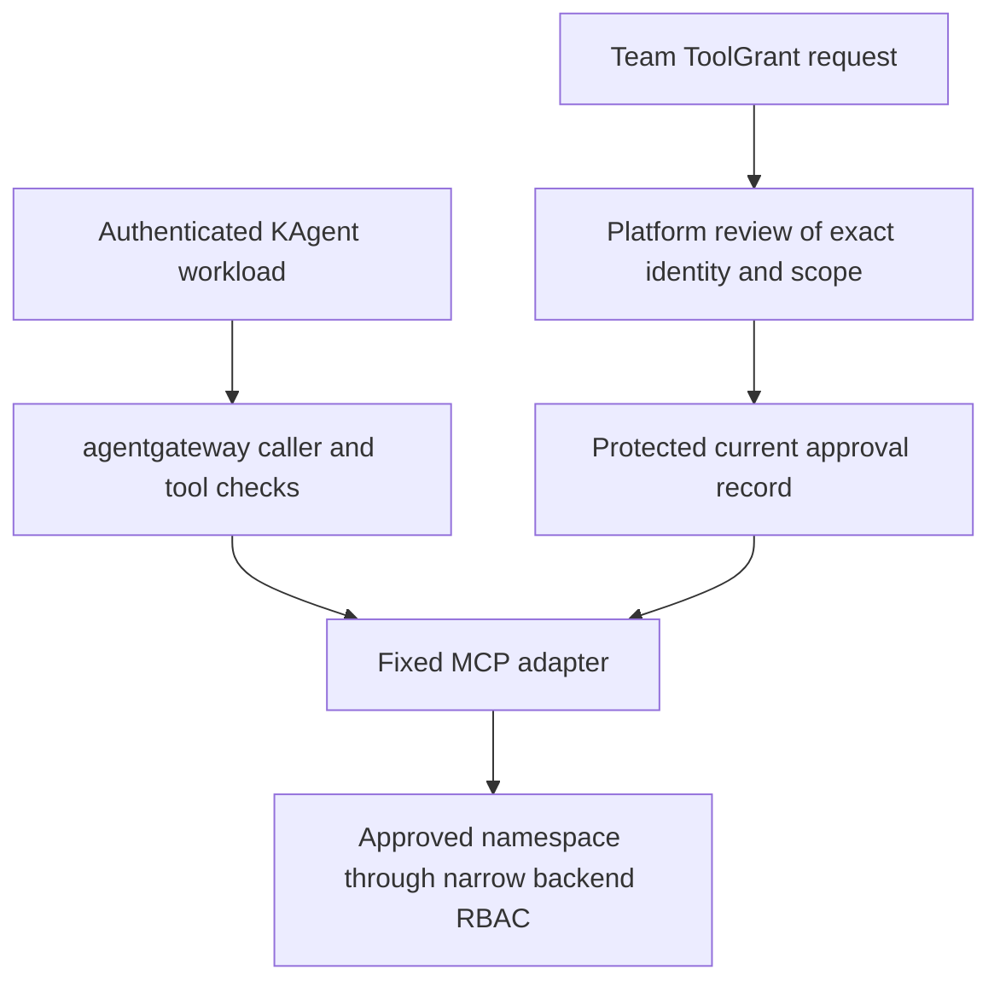

# Read-only MCP grants for HostedAgent

Status: proposed contract, 21 October 2026. This directory contains a design and synthetic fixtures. It installs no CRD, controller, identity, policy or tool. The current HostedAgent profile still requires `toolGrantRefs: []`.

A team requests named tools in GitLab. Platform reviewers approve the exact workload, tool contract and target scope. Agentgateway checks the authenticated caller and tool name. A fixed MCP adapter checks current approval on every call and performs only the approved reads.

## The owner's request

The existing [ToolGrant request fixture](examples/toolgrant-request.yaml) uses `platform.kagent.dev/v1alpha1`. It requests two proposed operations from a separately reviewed catalog release:

- `get_deployment_health(deploymentName)` returns deployment counts and selected condition statuses.
- `list_deployment_warning_summaries(deploymentName, limit)` returns selected warning categories and counts.

Both operations use one platform-bound cluster and namespace. Neither accepts a namespace, cluster, resource kind, selector, URL, command, kubeconfig, SQL or output template. These tool names describe a future adapter. They are not tools already running on the platform.

A future immutable HostedAgent request would contain this fragment:

```yaml
# Proposed profile only. The current CRD/controller rejects this configuration.
spec:
  runtimeProfile: namespace-readonly-v1
  toolGrantRefs:
    - deployment-observer-v1
```

The new profile initially accepts one grant for the generated Agent in the same namespace. The documentation profile continues to accept none. The platform must explicitly add the new profile to the approved profile registry and installed schema. Merely permitting nonempty arrays is not sufficient.

A ToolGrant is a request, including when a namespace administrator writes an `Approved` status or changes its labels. Its existence does not approve access. Namespace-local changes never create shared platform permission.

## The approval contract

The platform reviews observed objects and creates a separate RuntimeGrantRecord in a protected platform namespace. RuntimeGrantRecord is a logical data format, not a new Kubernetes kind. The first implementation can store one record per grant in a protected ConfigMap, with one publisher owning all writes. The team cannot edit that namespace or publisher.

The [record schema](runtime-record.schema.json), [operation contract](operation-contract.json) and [synthetic staged record](examples/runtime-record.json) make the required fields concrete. The record pins:

- Request namespace UID, ToolGrant UID and canonical spec SHA256.
- HostedAgent, generated Agent and ServiceAccount identities, plus HostedAgent and Agent spec hashes.
- Verified workload issuer, audience and principal, its admin trust domain, and identity/A2A proof hashes.
- Catalog UID/spec hash, reviewed operation contract hash, immutable adapter image and downstream identity/profile hash.
- Exact target cluster, namespace UID, named operations, output limits, approval provenance and mandatory validity times.

Canonical spec hashes use UTF-8 JSON with sorted keys and separators `(',', ':')`, then SHA256. They exclude status and metadata. Object UIDs are separately pinned. Catalog and operation-contract pins describe reviewed behavior, not a `readOnlyHint` or tool-name classification alone.

The initial validity ceiling is eight hours. A shorter request expiry wins. Renewals, wider scope and object replacements require a new reviewed approval ID. Record revisions advance through compare-and-swap writes. A Revoked approval ID is terminal and must never become Active again. The schema describes the record's shape. Runtime checking must additionally verify UID/hash equality, contract hashes, active state, time, current source consistency and approval provenance. The JSON fixture deliberately uses synthetic identities and digests.

## Identity and team authority

The first profile authorizes a **namespace administrator trust domain**. A namespace administrator can run a Pod as a local ServiceAccount or copy credentials available to that namespace. Assigning a dedicated identity to an Agent does not isolate it from that administrator. The approval bounds that trust domain to its approved backend, operations and resource scope.

A distinct Agent principal remains useful for ordinary workload separation and audit. A different principal must fail authorization, even with forged `x-agent`, namespace or tool-name headers. Bearer-token possession can still confer the approved access. Sender-bound replay prevention requires a separately proven mechanism.

If individual Agent isolation from the team's namespace administrators is required, host the operational runtime and credential delivery in a protected platform trust domain. Do not advertise individual Agent isolation from a UID field or local ServiceAccount alone. That protected hosting mode is outside this first profile.

The target must prove per-workload token acquisition, gateway audience, refresh/reconnect and authenticated A2A access to the selected Agent. An authenticated user must also be authorized for that Agent and session. Shared controller credentials and tenant-selectable authorization headers do not satisfy this proof. Native KAgent STS/header APIs are compatibility evidence only.

## Runtime enforcement



The adapter admits only authenticated gateway transport and independently verifies the original signed caller credential for the agreed protected resource. Credential relay is confined to this approved gateway/adapter path. It does not forward that credential to Kubernetes or another destination. The MCP backend uses its own narrowly scoped identity for downstream reads.

For each `tools/list` and `tools/call`, including calls on an existing session, the adapter reads the current protected record and required live object identities from the selected authoritative store. It compares the exact issuer/audience/principal, request and subject pins, active state, capability contract, operation and fixed scope. It does not cache successful authorization or treat session creation as authorization for later calls.

The store must supply a proven current, linearizable read through every replica/cache path. A Kubernetes informer cache or eventual watch is insufficient for this decision. If the chosen API/store cannot prove that consistency, access remains disabled until the contract changes explicitly. Missing records, failed reads, identity drift, unknown time and lost protection deny access.

Gateway policy narrows caller, backend and tool name. The adapter parses the closed operation schema and injects fixed target context. Backend RBAC limits the actual resource access. KAgent `toolNames`, admission and prompt instructions improve configuration and usability, but cannot replace these call-time checks. An existing session or a raw guessed MCP call must receive the same denial.

The adapter dispatches native API operations without a shell. Initially its backend Role permits only `get` on `deployments.apps` and `list` on core `events` in the approved target namespace. There are no Secrets, ConfigMaps, Pod logs, exec, watch, proxy, impersonation, token requests, wildcard resources or mutation verbs. Event reads are filtered to the selected Deployment UID. The platform owns the backend, identity and ingress protection outside team authority. An editable team NetworkPolicy alone cannot prevent bypass.

Health output includes the deployment name, generation/observed generation, replica counts and known condition types/statuses. Warning output maps reviewed reason codes to fixed categories, counts and times. It omits event `message`/`note`, manifests, annotations, environment values and free-form descriptions. Output remains untrusted data for the model. Unknown warning categories use a fixed `Other` value rather than returning arbitrary text.

Maximums are proposed defaults: 50 entries, 512 characters per approved string field, 32 KiB for the complete serialized client-visible MCP result, and a five-second whole-call deadline. Serialization and escaping count toward the byte limit. Return explicit truncation metadata. Do not follow pages automatically or expose page tokens that reconstruct an export. Batches, watches, background tasks and streaming result bodies are excluded from the first profile.

## Activation without a readiness cycle

1. Reconcile the immutable request and grant references. Create the account and a tool-less Agent so its UIDs and identity can be observed. It may be Ready for documentation; the proposed ToolAccess condition remains false.
2. Verify the fixed adapter, gateway policies, identity refresh, A2A access, resource scope and backend negative tests with platform test principals. Do not require the new Agent already to have working MCP access.
3. Platform review publishes a **Staged** record pinned to the observed UIDs and the calculated final Agent spec hash. This state grants no tool access. The final hash is computed from the reviewed request and profile before changing the Agent.
4. Install the generated RemoteMCPServer/tool wiring while the record remains Staged. Tool discovery may fail during this denied stage. Observe the actual Agent spec matching the approved final hash; do not wait for tool readiness here.
5. Publish **Active** only after protected policy/backend installation and exact identity/spec checks. Tool discovery can now succeed. Mark ToolAccess Ready only after current wiring and protection checks. Run fresh native acceptance separately.

No team-controlled status transition activates a record. No approval depends on an Agent being Ready before it can be authorized. Repeated reconciliation is idempotent. Partial rollout remains denied. Future implementation must keep records and generated wiring under separate writer identities.

## Expiry, revocation and drift

A GitLab merge requests a change. Revocation's runtime boundary is the durable transaction that sets the protected approval to Revoked or removes it. The runtime receipt identifies that commit, revision and time. Report runtime revocation only after backend-observed denial checks.

A call whose linearizable authorization read begins after that transaction must deny. A call whose read began earlier may already be authorized and may dispatch after the transaction. Bind its decision to one invocation and operation. Never reuse an Allow result. Start the proposed five-second monotonic whole-call deadline before the authorization read, and recheck expiry and the deadline immediately before downstream dispatch.

This bounds the earlier-read race to the remaining call deadline once implemented and proved. It is not a zero post-commit-dispatch guarantee. Reads already performed cannot be undone, and network delivery of earlier output cannot be retracted. Strict fencing or quiescence would require additional machinery and a separately reviewed contract.

For both time boundaries, require measured clock uncertainty of at most two seconds. Admit only when `now - uncertainty >= notBefore` and `now + uncertainty < expiresAt`, at authorization and immediately before dispatch. Apply the same conservative handling to required JWT validity times. This avoids starting early or extending expiry. Unknown/excessive uncertainty or a detected clock discontinuity denies. The whole-call deadline uses monotonic time. These are design acceptance targets, not measured lab timings.

Record unavailability denies every new authorization. No positive cache, stale lease or session state extends access. UID/spec mismatch, changed catalog/adapter/backend contract, deleted request, or namespace/Agent/ServiceAccount replacement denies on the next fresh decision. Catalog/contract observations must use the same current-read discipline. The record publisher never silently rebinds a same-name replacement. Gateway configuration drift cannot bypass an independently denying adapter.

A request remains documentation-capable if its MCP grant expires. Unready status is an observation; the adapter's call-time denial supplies revocation. Deleting an Agent or waiting for Flux is not the revocation mechanism.

## Implementation boundaries

| Future location | Sole responsibility |
| --- | --- |
| `platform/tool-grants/contract.py` | Parse requests, reviewed capability descriptors and approval records into immutable domain types; canonical pins and closed operation schemas. |
| `platform/tool-grants/publish.py` | Platform-owned review/provenance checks and staged/active/revoked record transactions. It cannot infer approval from team input. |
| Fixed MCP adapter | Verify caller and current records/objects for each invocation, then run exact bounded API operations. It reads records, never writes approvals. |
| `platform/skills-registry/hosted/` | Explicit approved profile registry, future nonempty-reference schema/admission, staged Agent wiring and ToolAccess conditions. No automatic widening of the existing profile. |
| `platform/agentgateway/` | Installed-version render of authenticated target/tool policies and protected backend transport. |
| New manual acceptance runner | Raw MCP allow/deny tests followed by native KAgent proof; separate from existing skill-only and document-only evidence policies. |

The public operation is `authorize_and_read(verified_caller, parsed_operation, invocation_context) -> BoundedResult | Denial`. It owns the fresh-read/dispatch boundary. Internal parsing yields immutable `RequestPin`, `SubjectPin`, `CallerBinding`, `CapabilityPin`, `FixedScope`, `ActiveGrant` and a closed operation union. An `ActiveGrant` can only be constructed after current-record checks. The team never receives a generic `execute(tool, arbitrary_json)` API as authority.

Use a thin transport and a pure decision function over the verified caller, current observations, parsed operation and trusted time. Keep one checked decision for one dispatch. Do not scatter independent allow lists across Agent YAML, gateway policy and backend code; derive them from the reviewed operation contract.

The content adapter keeps its current authority. It receives no grant reads, approval writes, Agent writes or Secret access. Hosted onboarding receives only the narrow reads needed for its new profile and never publishes protected approval records. The publisher and adapter use scoped record/object access; neither needs arbitrary Secret reads or cluster administrator credentials.

## Review decision and remaining proof

[DECISION.md](DECISION.md) compares the two designs. The selected design keeps enforcement inside the necessary fixed adapter. It accepts a fresh authoritative-read dependency for every call, instead of adding a signing broker and residual capability lifetime. This suits the first small read-only capability. Any later cache/lease optimization must explicitly redefine stale-access and revocation semantics.

Boundary Discipline puts enforcement at the gateway and adapter. Model the Domain separates an untrusted request from a verified active grant. Prove It Works requires backend-observed denial receipts before enabling the profile. These principles shaped those specific choices.

Validate the local examples with the handoff's Python dependencies:

```bash
python3 -B tool-grants-design/verify-design.py
```

The fixture dates are fixed at 22 October 2026, with a four-hour proposed validity window. Validation does not move them forward or treat the staged example as permission. Synthetic UIDs, proof hashes and approval commit values are illustrative.

The remaining work is implementation and the [fresh acceptance matrix](ACCEPTANCE.md). The local fixture verifier checks record/request shape and reference agreement only. It proves neither approval authority nor deployed authentication, authorization, revocation or isolation. See [EVIDENCE.md](EVIDENCE.md) for the inspected code and current upstream documentation.
