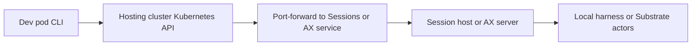
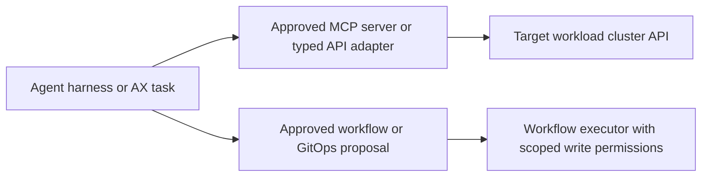

# Sessions and AX from a dev pod in an air-gapped workplace

Reviewed against the pinned home-lab builds on **29 October 2026**. These are
deployment guides and sanitized lab receipts. They do not contain executable
archives, container-image archives, credentials, or a completed offline release.

Start with the individual [Sessions POC](../agent-sessions-poc/README.md) and
[AX POC](../google-ax-poc/README.md) guides. The earlier
[architecture comparison](https://github.com/davidmarkgardiner/kagent-public/blob/main/docs/google-ax-kagent-comparison/README.md)
explains the overlap with kagent.

Copy the three sibling folders together when taking these guides into work.
Upstream URLs are source references, not runtime dependencies or instructions to
fetch public content from inside the air gap.

## Yes, the client can run in a dev pod

A dev pod can run either CLI and connect to a Kubernetes cluster elsewhere,
provided its network route, CA trust, credentials, and RBAC allow the required
operations. A Docker daemon or privileged dev pod is not needed just to run the
clients. Installing a CLI does not install its remote server or sandbox runtime.

| Component | Sessions | Google AX |
|---|---|---|
| CLI | `agentctl` | `ax` |
| Server | `agentsessionsd`, or the CLI's embedded local host | `ax-server` |
| Persistent control-plane state | SQLite journal in the reference implementation | PostgreSQL |
| Agent implementation | A compatible harness; model effects pass through the host | A runner image and task command |
| Compute | Local, remote, or Substrate backend; memory features depend on backend | Agent Substrate is required for tasks |
| Kubernetes requirement | Optional for the basic replay path | Required for this AX/Substrate deployment |

The practical choices are:

- **Sessions inside the dev pod.** Start with the embedded CLI or a loopback
  daemon and a persistent journal volume. This needs no Kubernetes API access
  unless the agent's tools need it. Plain-pod execution does not itself create an
  isolation boundary for untrusted agent code.
- **Remote backend, dev-pod client.** Install the backend in an approved hosting
  cluster. Keep the dev pod as an administrative client using an approved tunnel.
- **AX execution.** Put AX, PostgreSQL, and Substrate in a suitable hosting
  cluster. The dev pod submits tasks; the remote workers run them. An ordinary
  unprivileged dev pod cannot supply the node-level Substrate runtime by itself.

## There are two different Kubernetes connections

The first connection manages the agent platform. Kubernetes port-forward can
carry access through the hosting cluster's API without exposing its private
Service addresses to the dev pod:

This requires reachability to the API and its port-forward streaming support,
plus discovery and `pods/portforward` permissions in the relevant namespaces.
It is not satisfied by an arbitrary read-only kubeconfig. Use an explicitly
selected context and the organization's approved identity mechanism. A service
account automatically mounted in the dev pod normally identifies it to its own
cluster, not an unrelated remote cluster.

Kubernetes authorizes port-forward through the API server, and it can bypass
network-level controls. Restrict its RBAC independently of backend API access.
[Kubernetes port-forward guidance](https://kubernetes.io/docs/tasks/access-application-cluster/port-forward-access-application-cluster/)

The second connection is an agent inspecting or changing a workload cluster:

That target may differ from the hosting cluster. Neither product automatically
gives an agent the dev pod's kubeconfig or Kubernetes tools. Model and tool
requests originate from the host, harness, or task selected by the integration,
so their network routes and credentials must work there, not just in the dev pod.

For this platform, start with fixed read-only tools and namespace-scoped
identities. Keep changes behind approved Argo or GitOps flows. The workflow
service account holds write permissions; the chat or agent front door does not
need broad apply/delete authority. Keep kubeconfigs, access credentials, and
provider keys out of prompts, workspaces, task config, journals, and this bundle.

## Transport and identity require a workplace design

Both pinned reference clients use plaintext gRPC by default. AX's client even
strips an `https://` prefix before making an insecure gRPC connection. Adding
that prefix is not TLS configuration. Use a protected loopback tunnel for a
bounded evaluation, or a reviewed client/server transport and authentication
integration. Do not directly expose the reference services as shared workplace
APIs without that work.

Sessions' reference daemon has no built-in caller authentication, authorization,
or TLS. Its `project` is a filter, and an approval identity field is provenance,
not proof of permission. Custom Go hosts have optional auth hooks. An approval
demo does not establish an enterprise approval boundary.

AX control-plane forwarding and guest access are separate paths. The pinned
`ax ssh` tries direct worker access, then router mTLS through Kubernetes
port-forward, then a plaintext router fallback. The mTLS helper lists
ClusterTrustBundles and creates, reads, and deletes PodCertificateRequests for
the configured AX service-account identity. That needs platform review; do not
grant it broadly to dev-pod users. Approve a fail-closed guest-access design and
validate it against the installed signer and router policies. A successful
`ax get tasks` does not prove guest access will work.

Sources: pinned [AX connection code](https://github.com/google/ax/blob/8440ae689d3314954b4f9f91d5b1460bdf5d6120/cmd/ax/main.go),
[router TLS helper](https://github.com/google/ax/blob/8440ae689d3314954b4f9f91d5b1460bdf5d6120/internal/tunnel/router_tls.go),
[Sessions client](https://github.com/agent-primitives/sessions/blob/7531d2026252df8617b20d1f0d19240962408c80/client/client.go),
and [Sessions security posture](https://github.com/agent-primitives/sessions/blob/7531d2026252df8617b20d1f0d19240962408c80/docs/security.md).

## Air-gap preparation

An air gap still needs approved internal connectivity. Kubernetes, model APIs,
MCP servers, registries, Git, identity issuers, DNS, PKI, and storage must be
reachable wherever their respective clients run.

Prepare artifacts in the approved connected build/import environment:

| Artifact group | What must be available internally |
|---|---|
| Dev-pod tools | Exact OS/architecture CLI binaries, `kubectl`, any kubeconfig exec-auth plugin, approved CA bundles, and applicable licenses/checksums |
| Sessions | The selected daemon and harness binaries or images, application dependencies, journal storage, optional executor, and configured model route |
| AX | AX server and runner images, PostgreSQL, Substrate controllers/workers, certificate components, storage integration, and chosen runtime assets |
| Task environment | Git clients, Python or other runtime, packages, CA trust, scripts, and tools already built into the approved image |
| Content | Internal Git mirrors, approved revisions, skill content, and MCP endpoints/catalogs with public defaults removed |
| Models | Approved internal model gateway, or mirrored inference image and weight files if hosting the model internally |
| Build environment | Pinned source, Go toolchain and complete module graph; Docker/Buildx, base images and package repositories; Rust/Cargo inputs if rebuilding Substrate's Envoy component |

Importing complete prebuilt runtime images avoids needing compilers and public
package repositories at runtime. If builds must occur inside the air gap, the
complete build graph must also be imported or served by approved internal
mirrors. Automatic Go toolchain downloads, Cargo fetches, `apt`, `pip`, and
startup-time package installation otherwise remain external dependencies.

Record source commits, architecture, source and imported image digests, binary
SHA-256 values, SBOMs where available, and internal artifact locations. The
lab-built AX images were published only to a lab registry. Their digests do not
make them downloadable from this GitHub folder. Build/import them through the
approved pipeline before using internal deployment references.

### Substrate assets are separate from images

For the AX POC's Substrate v0.6.0, `SandboxConfig` version `v4` references a
`gvisor.tar.zstd` archive containing `runsc` **and its helper binaries**. The
versioned field is `spec.versions[].assets.<arch>.gvisor`. The AX folder records
the [exact source URLs and hashes](../google-ax-poc/runtime-assets.json).

Mirror the complete archive and configure the supported internal object-store
asset provider, permissions, and CA trust. The pinned asset fetcher tries the
plugin first and can fall back to anonymous public GCS for `gs://` entries after
certain failures. Configure and test internal-only resolution; a warm node cache
can hide a missing import. Do not assume an arbitrary HTTPS URL works, or reuse
the older runsc-only v0.0.9 recipe on v0.6.0.

Pinned references: [SandboxConfig](https://github.com/agent-substrate/substrate/blob/d3f2363590a11b2f50489971985ba033b4c9eff7/manifests/ate-install/sandboxconfig-gvisor.yaml),
[fetcher](https://github.com/agent-substrate/substrate/blob/d3f2363590a11b2f50489971985ba033b4c9eff7/cmd/atelet/sandbox_assets.go),
and [cache contract](https://github.com/agent-substrate/substrate/blob/d3f2363590a11b2f50489971985ba033b4c9eff7/docs/sandbox-asset-cache.md).

## Workplace acceptance order

1. Confirm the hosting and workload clusters, approved identity, API routes,
   storage, model endpoint, tool scope, and platform owner.
2. Validate the target Kubernetes APIs, admission rules, node permissions,
   certificate signers, storage and sandbox support. The lab used Kubernetes
   v1.37 for AX; it does not establish AKS or workplace compatibility.
3. Import the complete artifact set. Rewrite public image, asset, Git, model,
   MCP and telemetry endpoints to approved internal routes.
4. Start with Sessions replay in a single dev pod if Substrate is not yet
   approved. Keep its journal on durable storage and test restoration after
   replacing the pod. SQLite backup must be consistent with its WAL state.
5. Validate remote client access, including token refresh and CA trust. Validate
   AX guest access separately from control-plane reads.
6. On a fresh pod and fresh worker cache, deny public egress and repeat the
   relevant POC. Capture DNS/egress evidence and fail acceptance on unapproved
   external fetch attempts, even if a cached run succeeds.
7. Add one bounded internal model/tool canary. Verify where calls originate,
   identity, denied operations, output, and internal telemetry.
8. Prove recovery and operator cleanup. Sessions `Cancel` is unimplemented and
   its deletion only records intent; provision explicit runtime cleanup.

These are pending workplace gates. Neither home-lab POC ran in a clean-room air
gap, an enterprise dev pod, or a workplace target cluster.

## Configuration

The individual guides use `{{PLACEHOLDER}}` values for kubeconfig paths, contexts,
namespaces, journal paths, internal images, models, and storage. Resolve them only
inside the approved workplace. Never put the filled credential-bearing config
back in the public repository.
