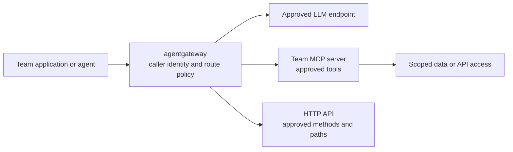

# Bring your LLMs, MCP servers, and APIs to agentgateway

Allow 10 minutes. Use this as a YAML-first companion to the
[Microsoft agent walkthrough](../../docs/demos/microsoft-2026-10-15/yaml-walkthrough/README.md)
and the [tenant-isolation architecture](../kagent-agentgateway-tenant-isolation/ARCHITECTURE.md).
The examples explain an onboarding proposal. They do not establish a working
integration in the incoming team's environment.

For this meeting, imagine your team owns an incident assistant, a model
endpoint, and an incident lookup service. We follow those through the gateway.
Your agent runtime still owns the model/tool loop.

## 1. Show the request path, one minute

Say: "You bring the service and its contract. The platform publishes an
approved route, identity policy, and support contract for its consumers."



There are two different requests. Consuming an existing model or MCP uses the
[application onboarding scenario](scenarios/01-llm-postgres-mcp.md).
Publishing a new backend uses this walkthrough and a separate provider review.
Backend registration does not grant every team access.

The platform owns shared listeners, routes, authorization, and backend
credential references. Your team owns its service, release, resource
permissions, and support. DNS, TLS, connectivity, and an agreed authentication
method are prerequisites for every integration.

## 2. Bring a model endpoint, two minutes

Open the annotated [ModelConfig](../../docs/demos/microsoft-2026-10-15/yaml-walkthrough/05-model-garden.yaml),
then the [provider backend and route examples](../../platform/agentgateway/backend-openai-compatible-external-models.yaml).
Read the fields as a request journey, not as an apply sequence.

```text
application SDK, or kagent Agent -> ModelConfig
  -> approved gateway model URL and model name
  -> HTTPRoute -> AgentgatewayBackend -> your model service
```

The `ModelConfig.openAI.baseUrl` points to the gateway. The route selects the
backend. The backend supplies the provider host, port, API mapping, and
credential reference. A plain application uses its SDK configuration instead
of a kagent ModelConfig.

Your team supplies the endpoint, exact model/deployment names, supported API
format, region, context/output limits, streaming and tool-calling support,
quota, billing owner, and provider authentication contract. "OpenAI compatible"
needs an exact path and API test. Chat Completions support alone does not
establish Responses API support.

The platform reviews that contract, configures the upstream identity, and
authorizes named consumers for the approved model. It provides the consumer
with a gateway URL, model name, authentication method, and limits. The consumer
does not receive the provider credential.

Show [traffic limits](../../docs/demos/microsoft-2026-10-15/yaml-walkthrough/15-model-traffic-limits.yaml)
and [metrics collection](../../docs/demos/microsoft-2026-10-15/yaml-walkthrough/18-gateway-podmonitor.yaml).
These examples require target-version checks. Their local rate limits apply
per proxy replica. A monetary budget needs a separately verified control.

Expected acceptance evidence is one bounded model response, the expected
upstream model, usage metadata, and rejection of an unauthorized caller or
model selection. Test streaming and tool calls if the application needs them.

The official [provider guide](https://agentgateway.dev/docs/kubernetes/latest/integrations/llm/providers/)
distinguishes dedicated provider types, OpenAI-compatible providers, and
custom providers. Choose the shape supported by the installed release.

## 3. Bring an MCP server, two minutes

Open the annotated [MCP backend](../../docs/demos/microsoft-2026-10-15/yaml-walkthrough/07-mcp-backend.yaml),
[HTTPRoute](../../docs/demos/microsoft-2026-10-15/yaml-walkthrough/08-http-routes.yaml),
and [RemoteMCPServer](../../docs/demos/microsoft-2026-10-15/yaml-walkthrough/06-remote-mcp.yaml).

```text
agent MCP client -> gateway MCP URL
  -> HTTPRoute -> AgentgatewayBackend static target
  -> your MCP Service at /mcp using Streamable HTTP
  -> data/API using the MCP server's scoped identity
```

Your team supplies an immutable image/version, source provenance, service
address and MCP path, transport/session behavior, full tool inventory, input
schemas, read/write classification, and downstream permission scope. A
local stdio-only server needs an approved hosted transport arrangement before
it can use this static Streamable HTTP pattern.

The platform reviews the server using the
[BYO MCP promotion gate](02-PLATFORM-MCP-CATALOG.md#bring-your-own-mcp-promotion-gate).
It registers the backend, attaches a route and identity/tool policy, and
restricts direct backend access. The consumer gets the gateway MCP URL and
the approved tool names. A kagent consumer uses a RemoteMCPServer and an
explicit Agent tool selection.

For the incident service, start with one read-only lookup tool. Discover the
actual client-visible name with `tools/list`, including any gateway target
prefix. Then make one `tools/call` against a synthetic incident. Verify that
an unlisted tool and an incident outside the permitted team both fail.

A tool-name policy cannot enforce which rows, namespaces, or subscriptions
the tool accesses. The MCP server and downstream identity enforce that scope.
Keep responses bounded and redact sensitive fields before results reach the
model. Write tools need a separate approval and execution design.

## 4. Bring an API, two minutes

First decide how the consumer uses the API.

| Consumer need | Integration path | What the team supplies |
|---|---|---|
| An application calls REST directly | HTTPRoute to the approved HTTP backend | Method/path contract, schemas, TLS, auth, and resource permissions |
| An agent discovers and calls tools | MCP facade over selected API operations | Reviewed operation inventory plus an MCP adapter or supported OpenAPI conversion |

For direct HTTP, an illustrative request is `GET /v1/incidents/DEMO-001`.
Publish only the approved method/path contract and keep API-side resource
authorization. HTTP routing does not turn REST into MCP. The official
[HTTP quickstart](https://agentgateway.dev/docs/kubernetes/latest/documentation/quickstart/non-agentic-http/)
shows the Service-backed HTTPRoute pattern.

For tool access, propose this mapping for review:

```text
MCP lookup tool(incident_id)
  -> GET /v1/incidents/{incident_id}
  -> team-scoped API identity
  -> bounded incident summary
```

Your team supplies a versioned OpenAPI document where available, stable
operation IDs, parameter and response schemas, auth requirements, and the
exact read-only subset. Include pagination, error behavior, timeouts, and
result-size limits. Do not expose the entire API by default or accept arbitrary
destination URLs from tool arguments.

Open the existing [OpenAPI schema gate](../../platform/agentgateway/DEMO-SCHEMA-GATE.md)
and [Argo backend warning](../../platform/agentgateway/backend-argo-openapi-mcp.yaml).
The recorded 14 May 2026 cluster rejected `mcp.targets[].openapi`. That is
historical evidence for that installation, not a current check of this team's
cluster. The official [standalone OpenAPI example](https://agentgateway.dev/docs/standalone/latest/integrations/mcp/servers/openapi/)
documents conversion in a different configuration mode.

Before promising native conversion on Kubernetes, verify both the installed
CRD and runtime behavior. If unsupported, use a small reviewed MCP adapter
around the selected API operations and onboard it through step 3. A Swagger
page or a successful REST response does not prove an MCP integration.

## 5. Connect this to agent isolation, two minutes

Open [the child-agent MCP policy](../../docs/demos/microsoft-2026-10-15/yaml-walkthrough/13-agent-to-mcp-policy.yaml)
and [the network boundary](../../docs/demos/microsoft-2026-10-15/yaml-walkthrough/14-mcp-network-boundary.yaml).
For application-to-agent traffic, also show the
[separate A2A policy](../../docs/demos/microsoft-2026-10-15/yaml-walkthrough/12-application-to-agent-policy.yaml).

Say: "The route selects the destination. Verified identity and policy decide
who may invoke it. Backend permissions decide what the invocation can access."

An HTTPRoute does not restrict caller namespaces. `allowedRoutes` controls
route attachment. A ReferenceGrant permits a configuration reference across
namespaces. Neither grants invocation permission. Gateway policy, backend
authorization, network controls, and admission/RBAC ownership work together.

Keep caller-to-gateway authentication separate from gateway-to-backend
authentication. For the Entra design, validate issuer, signature, expiry,
audience, and the intended caller identity and role. Do not trust a supplied
`x-kagent-*` header as caller identity. App-to-agent and agent-to-MCP tokens
have separate audiences and permissions. Token acquisition, refresh, and
client reload need their own proof.

Before calling an integration available, collect the
[acceptance evidence](evidence/ACCEPTANCE-CHECKLIST.md) for its applicable paths:

- The approved caller reaches the approved model, tool, or API operation.
- Missing, expired, wrong-audience, and wrong-team credentials fail.
- Unapproved models, tools, API operations, and resource scopes fail.
- A denied request does not reach the backend, confirmed by a counter or trace
  alongside a successful positive control.
- An unauthorized pod cannot bypass the gateway to reach the backend.
- Token rotation and policy reload preserve authorization. Audit records
  identify caller, route, outcome, latency, and available usage without secrets
  or unapproved payloads.

The incoming team leaves with named platform and backend owners, an agreed
first read-only use case, and a completed
[BYO integration intake](templates/byo-integration-request.yaml).
The platform renders the reviewed changes into its GitOps delivery flow,
validates against the target schema, and promotes only after the evidence
passes. This walkthrough deploys nothing and reruns no historical security test.
