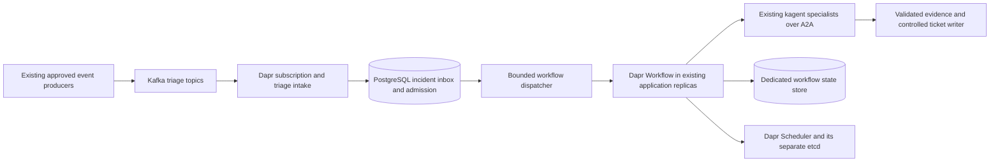

# Dapr replacement for Kafka-triggered Argo triage

This proposal replaces the triage route's Argo EventSource, Sensors and Workflows
with a long-running application using Dapr Kafka pub/sub and Dapr Workflow.
The objective is to absorb Kafka bursts without creating a Kubernetes Workflow
or execution pod for every event. Existing kagent specialists remain the agents.

Status: **design and implementation handoff only**. This folder contains a README,
not a working replacement, Helm values or deployment manifests. No Dapr capacity
test, target deployment or production cutover has been performed.

Download the full repository ZIP and copy this folder into the workplace repo.
The GitHub location is
https://github.com/davidmarkgardiner/kagent-work-bundles/tree/main/dapr-kagent-triage.

## Failure this design addresses

The reported incident was a Kafka event burst that overwhelmed the Argo path
and affected the Kubernetes cluster and its etcd database. The detailed incident
metrics and control-plane logs have not been inspected for this proposal.

The working hypothesis is excessive Workflow, Pod and status-update activity.
Argo documents Kubernetes API overload as a scaling concern at
https://argo-workflows.readthedocs.io/en/latest/running-at-massive-scale/.
That supports the mechanism, not a confirmed diagnosis of this incident.

The design requirement is that the event backlog does not become an unbounded
set of Kubernetes objects. An orchestration change also needs admission limits,
durable duplicate suppression and bounded downstream agent activity.

## Proposed architecture

Existing producer-side filtering and admission remain in place. The intake adds
the execution admission boundary needed to protect the management cluster.
Metric alerts and log/event evidence retain their existing source contracts.

| Existing responsibility | Proposed owner |
| --- | --- |
| Kafka EventSource and Sensor delivery | Dapr subscription plus application intake |
| Argo triage Workflow sequencing | Dapr Workflow code and activities |
| Incident claims and pending work | Dedicated PostgreSQL application tables |
| Workflow history | Supported Dapr workflow state store, initially PostgreSQL |
| Agent reasoning and MCP investigation | Existing allow-listed kagent A2A specialists |
| Ticket creation and updates | Idempotent writer with independent budgets |
| Deployment and configuration | Existing Flux and Helm delivery |

Dapr embeds its workflow engine in the sidecar. Workflow code and activities run
in application processes, and workflow history uses a supported state store.
PostgreSQL is supported. This design uses long-running Deployments rather than
per-event Jobs or Workflows. The engine architecture is documented at
https://docs.dapr.io/developing-applications/building-blocks/workflow/workflow-architecture/.

The application and its integration code still need to be built. Dapr's Kafka
component supplies broker integration, not the incident policy, kagent adapter
or ticket contract. Its component configuration is documented at
https://docs.dapr.io/reference/components-reference/supported-pubsub/setup-apache-kafka/.

## Storage and Kubernetes isolation

Kubernetes etcd continues to store cluster configuration. It must not become the
incident ledger, backlog or per-event workflow database. The proposal creates no
per-incident ConfigMaps, Secrets, custom resources or Jobs.

Dapr Scheduler has its own etcd database for scheduled work and workflow
reminders. It is separate from the Kubernetes control-plane database. A
PostgreSQL workflow store does not remove this Scheduler dependency.
Scheduler storage, retention and backup requirements are documented at
https://docs.dapr.io/concepts/dapr-services/scheduler/.

Separate databases can still compete for CPU, memory and disk. The proposed
deployment reserves resources and persistent storage for the Scheduler and
database, with approved worker placement and replica ceilings. Managed or
otherwise isolated PostgreSQL is preferable where the platform supports it.
No Dapr component connects to Kubernetes' control-plane etcd directly.

## Admission and delivery contract

The following are requirements for the implementation, not existing features
provided by this README.

1. Validate the exact approved input schema and source identity. Preserve
   `source_record_id` and the stable workload-based `incident_id`. Redact and bound
   evidence before it reaches the intake or model.
2. Atomically record accepted input, its incident disposition and any dispatch
   intent in PostgreSQL. Use unique keys for transport retries and workflow
   starts. A duplicate can update bounded incident counts without new execution.
3. Acknowledge input only after durable acceptance, or after a durable invalid-input
   disposition with a reliable DLQ handoff. A successful HTTP response alone must
   not acknowledge work held only in memory.
4. Bound pending database work as well as active work. When intake capacity is
   exhausted or PostgreSQL is unavailable, stop accepting new work through the
   supported retry/backpressure path. Verify the installed Dapr Kafka component's
   acknowledgement, partition and rebalance behavior under this condition.
5. Keep excess work in Kafka within its approved retention window. Monitor oldest
   message age and consumer lag. Kafka retention is finite, so capacity exhaustion
   requires operator action before evidence expires.
6. Dispatch only after obtaining a global investigation permit across replicas.
   Per-process limits and maximum pod counts alone do not establish that bound.
   Reserve model-call and token allowances separately.
7. Use a stable dispatch identity for workflow creation. Reconcile an uncertain
   start against its durable intent and workflow instance before another attempt.
   Do not claim end-to-end exactly-once effects from Kafka or Dapr delivery.

The global permit limits active work. A separate durable incident claim prevents
duplicate investigations. Recovery cannot free a permit and submit a new task
merely because a lease expired: the previous workflow and native task must first
be reconciled as terminal, cancelled or explicitly unresolved.

## Agent execution and ticket boundaries

The adapter selects one approved read-only specialist for the incident route.
It retains the native context, task and message identifiers and polls the same
task to completion. Model uncertainty and client timeouts do not automatically
authorize another paid investigation.

A2A submission can succeed before its response is lost. The adapter needs a
version-specific recovery route for that ambiguity. Where the installed API
cannot establish the existing task, the incident remains blocked for reconciliation.
Automatic retries of uncertain task creation or ticket creation are prohibited.

The workflow reuses deployed agents. It must not create an Agent, Harness or
deployment for every Kafka record. Any native actor/session creation is included
in the global execution cap and the Kubernetes load test.

The workflow application has no cluster mutation tools. The ticket writer owns
its credential and enforces its own create/update budget and incident key.
Remediation remains a separate human-approved GitOps or execution path. Approval
waiting never grants the triage application resource-changing permissions.

## Capacity controls

The proposed deployment needs these explicit limits and signals.

| Boundary | Limit | Required observation |
| --- | --- | --- |
| Kafka intake | Bounded message size, fetch buffers and handler concurrency | Lag, oldest age, retries and rebalance outcomes |
| Pending work | Global maximum pending incidents and dispatch intents | Pending count, age and rejection reason |
| Investigation | Global permits plus per-source fairness and model allowance | Active investigations, model usage and wait age |
| Dapr execution | Workflow/activity concurrency and capped application replicas | Activity backlog, replica use and retry rate |
| Storage | Reviewed retention, storage capacity and connection limits | PostgreSQL latency/growth and Scheduler etcd latency/growth |
| Kubernetes | Fixed control-plane deployments and capped worker replicas | API write rate, latency, object counts and control-plane health |
| Ticket delivery | Independent daily and update budgets | Creates, updates, duplicates and uncertain results |

Dapr does not impose a global workflow/activity concurrency limit by default.
Its application-level concurrency settings are only one part of admission.
Workflow capacity also depends on the state store and scheduler/reminder system,
as described in the workflow architecture reference above.

No events-per-second capacity or resource sizing is claimed here. Those values
must come from the recorded burst, workflow duration and target-cluster tests.

## Migration and rollback proposal

The migration has four gates. Each requires an explicit target-side change plan.

1. **Incident baseline.** Capture the original event rate, duplicate ratio,
   Workflow/Pod creation rate, API latency and etcd failure evidence. Record the
   installed Argo, Dapr candidate, Kafka and kagent versions. If the original
   failure cannot be reproduced safely, retain that limitation.
2. **Isolated load proof.** Use synthetic bounded records in a separate namespace,
   topic, consumer group and database. Begin with a stub investigator. Exercise
   overload, worker restart, database loss, duplicate delivery and uncertain starts
   without model calls or workplace ticket writes.
3. **Shadow and canary.** Shadow a separately scoped input stream without agent
   execution or ticket side effects. Then enable one bounded read-only canary
   using the actual kagent route and a dedicated test ticket destination.
4. **Controlled cutover.** Establish offsets and durable incident ownership before
   enabling the replacement. Disable legacy submission for the selected scope
   first. Never let both paths execute the same incident during migration.

Rollback first disables new Dapr dispatch and reconciles admitted work and native
tasks. It preserves Kafka offsets, database records and uncertain-effect receipts.
Re-enabling Argo requires a bounded, healthy legacy route and reconciled replay
scope. If the legacy route is unsafe, keep intake buffered or paused according
to the approved recovery plan. Reverting the router is not a reason to replay
the entire backlog or delete unresolved state.

## Acceptance before replacement

The replacement is ready only after target evidence demonstrates all of these.

- Replaying the recorded peak burst does not create per-message Kubernetes
  objects. Kubernetes API and control-plane etcd stay within pre-agreed bounds.
- Active investigations never exceed the global cap. Pending work also remains
  bounded. The backlog drains within the agreed recovery window after a burst.
- Worker crashes and Kafka redelivery do not produce duplicate paid investigations
  or duplicate tickets. Uncertain outcomes stop for reconciliation.
- PostgreSQL failure stops acceptance without acknowledging lost work. Restart
  recovers committed intents. Scheduler failure and recovery retain workflow state.
- Effective model, ticket, evidence-size and retention limits remain enforced
  across replica changes and restarts.
- A fresh real kagent canary returns attributable evidence. Its terminal native
  task and ticket receipt match the incident and workflow identifiers.
- Cutover and rollback preserve incident ownership and have no dual execution.

## Implementation scope and configuration

The first implementation consists of a small triage service, a Dapr subscription,
PostgreSQL inbox/admission tables, a bounded dispatcher, a Dapr workflow and an
A2A adapter. A direct Kafka consumer with the same durable admission is a smaller
alternative if multi-step workflow coordination proves unnecessary.

Platform-owned configuration must supply the following private values.

| Placeholder | Required input |
| --- | --- |
| `{{TARGET_NAMESPACE}}` | Dedicated approved namespace and worker placement |
| `{{PINNED_DAPR_RELEASE}}` | Reviewed runtime, chart and SDK compatibility |
| `{{INTERNAL_REGISTRY}}` | Approved mirrored images and chart artifacts |
| `{{KAFKA_SECRET_REF}}` | Existing scoped broker credentials and CA trust |
| `{{TRIAGE_TOPIC}}`, `{{CONSUMER_GROUP}}` | Approved source topic and dedicated trial group |
| `{{POSTGRES_SECRET_REF}}` | Least-privilege credentials for dedicated schemas |
| `{{KAGENT_A2A_ROUTE}}` | Approved agentgateway/controller route and identity |
| `{{GLOBAL_INVESTIGATION_LIMIT}}` | Fleet-wide execution limit, distinct from replica count |
| `{{MAX_PENDING_INCIDENTS}}` | Durable intake capacity and saturation policy |
| `{{TICKET_DESTINATION}}` | Approved test destination and writer policy |

Use the established Flux and HelmRelease process for the eventual installation.
The operator manages schemas, Secrets, CA trust, Dapr Scheduler storage, network
policy and backups. A restricted environment needs mirrored artifacts and a fresh
no-public-network rehearsal before any air-gap claim. Pin stable supported
versions and avoid preview features as a prerequisite for the first proof.

Dapr's Kubernetes installation and production guidance are available at
https://docs.dapr.io/operations/hosting/kubernetes/kubernetes-deploy/ and
https://docs.dapr.io/operations/hosting/kubernetes/kubernetes-production/.
